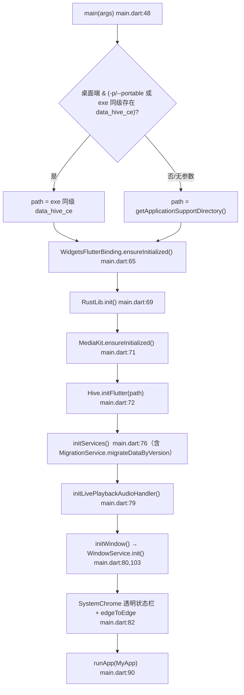
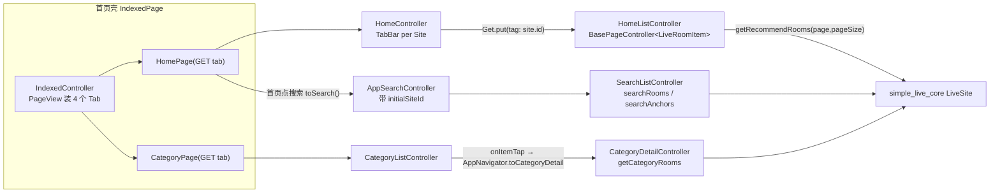
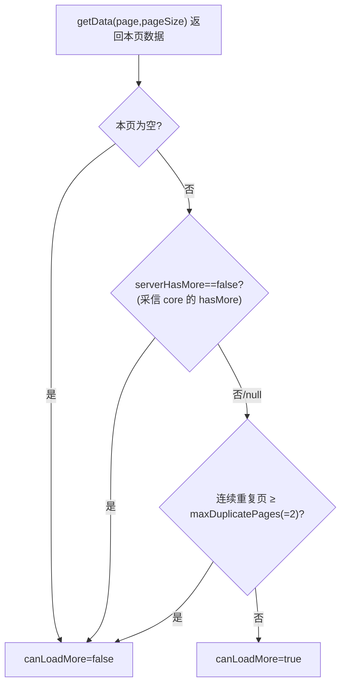
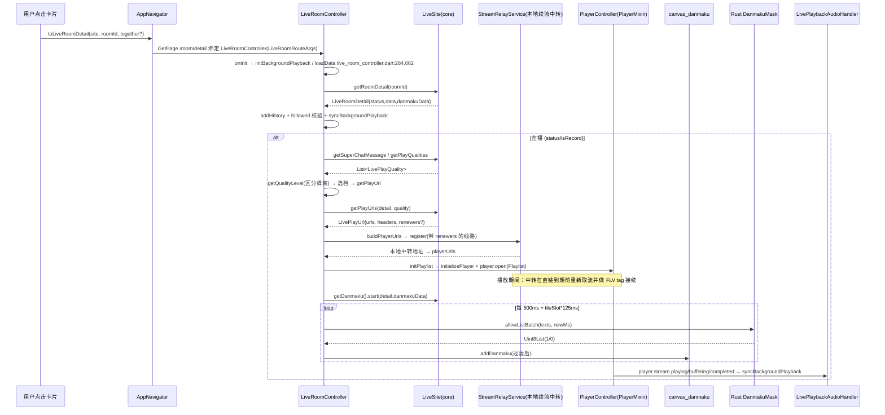
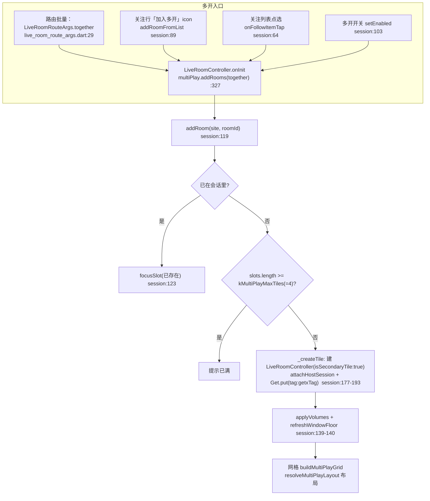
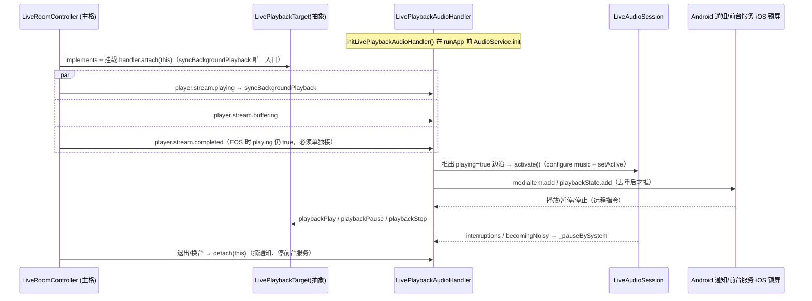
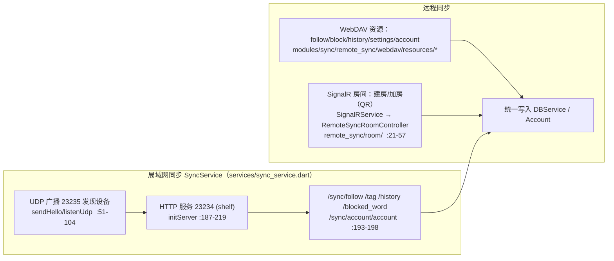
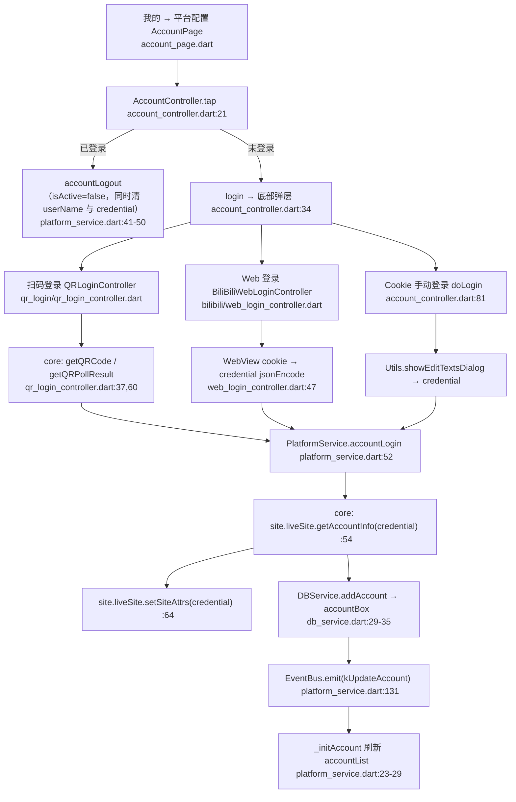
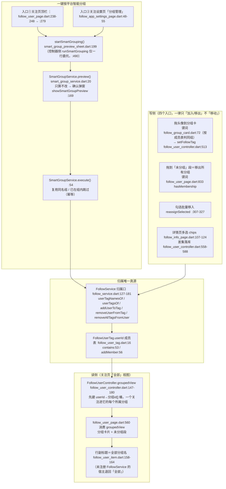

# simple_live_app 工作流程图

> 版本锚点：`simple_live_app` v1.8.15+10815 · future 分支 `5ae375f1`（2026-10-14）
> 配套文档：[architecture.md](./architecture.md)｜[update-history.md](./update-history.md)｜[backlog.md](./backlog.md)｜[test-suite.md](./test-suite.md)｜上游依赖：[simple_live_core 知识库](../../simple_live_core/doc/workflow-diagram.md)

## 0. 定位与消费边界

本组件是 UI 与播放层，**只消费 `simple_live_core`**：`Sites.allSites`（`lib/app/sites.dart:9-45`）为 5 个平台各持一个 `Site`（内含 `LiveSite` 单例），App 从不反向被 core 依赖。运行时被 App 吃掉的是三条数据流：**列表**（首页/分类/搜索）、**直播间**（详情→清晰度→播放地址 + 弹幕长连接）、**关注状态轮询**。播放与弹幕渲染全在 App 侧，core 只给「地址」与「消息」。

## 1. 启动链（`lib/main.dart`）

`initServices()`（`main.dart:107-148`）的注册顺序即依赖顺序：

| 序 | 调用 | 证据 |
| --- | --- | --- |
| 1 | `Hive.registerAdapters()` | `main.dart:108` |
| 2 | `Utils.packageInfo = PackageInfo.fromPlatform()` | `main.dart:111` |
| 3 | `Get.put(LocalStorageService()).init()`（Hive `LocalStorage` / `DanmuShield` 两箱） | `main.dart:114`；`local_storage_service.dart:363-370` |
| 4 | `Get.put(DBService()).init()`（History / FollowUser / FollowUserTag / FollowUserBlock / **account**） | `main.dart:115`；`db_service.dart:21-27` |
| 5 | `Get.put(AppSettingsController()).onInit()` | `main.dart:117`；`app_settings_controller.dart:76` |
| 6 | `Get.put(AppStyleSettingController()).init()` | `main.dart:119` |
| 7 | `FollowService` / **`SmartGroupService`**（`main.dart:124`，紧随 `FollowService:122` 注册，依赖前者）/ `MigrationService.migrateDataByVersion()`（`main.dart:127`，迁移须先于 `PlatformService`）/ `PlatformService` / `SyncService` / `HistoryService` / `FollowBlockService`（`BiliBiliAccountService` 已随账号迁 core 删除） | `main.dart:122-135` |
| 8 | 桌面端 `Get.put(WindowService())` | `main.dart:136` |
| 9 | Android `Firebase.initializeApp` + `Get.put(FirebaseService())` | `main.dart:140-145` |
| 10 | `initCoreLog()`：接管 `CoreLog.onPrintLog` 打到 `Log` | `main.dart:147,150-172` |

- **窗口要排在 `runApp` 之前**：`WindowService.init()`（`window_service.dart:106-149`）先 `resize()` 再 `waitUntilReadyToShow → show`，最大化在 `show` 之后做以防白屏。
- **后台播放 handler 必须在 `runApp` 前、且在服务就位后**：`AudioService.init` 内部要拿 `Get.find` 那批服务（`live_playback_audio_handler.dart:274-300`）。

#### 消费者需要知道的约定 / 易错点
- `main.dart:66-68` 注释写死的初始化顺序 `window(first)→migration→media_kit→Hive→services→start` 是**契约**，改顺序要考虑 `WindowService` 里对亮度插件 auto-reset 的关闭（`window_service.dart:163-170`）。**注**：`migrateDataByVersion()` 现已挪进 `initServices()`（`main.dart:124`），排在 `PlatformService` 之前。
- 桌面端 `MigrationService.migrateData()`（`migration_service.dart:16`，把 Hive 从 Documents 迁到 Support）当前**未启用**（`main.dart:70` 被注释），只跑按版本的 `migrateDataByVersion()`（`main.dart:124`）。
- `initCoreLog` 里 `CoreLog.enableLog = !kReleaseMode || logEnable`——上架版默认关闭 core 日志，抓问题时需先开「日志记录」。

## 2. 列表链（首页 → 分类 → 搜索 → 分页）

- **首页 site 切换**：`HomeController` 的 `TabController` 长度 = `Sites.supportSites.length`，每个 tab 注册一个带 tag 的 `HomeListController`（`home_controller.dart:43-45`）；tab 下标→site id 的唯一映射是顶层纯函数 `siteIdAtHomeTab`（`home_controller.dart:15-21`，有单测 `test/home_site_id_test.dart`）。
- **把平台带给搜索页**：`HomeController.toSearch()` 传的是 **id 而非下标**（`home_controller.dart:63-70`），搜索页据此默认选中同平台（`search_controller.dart:28-38`）。
- **分类详情**按 `subCategory` 走 `getCategoryRooms`；**搜索**按模式走 `searchRooms`（直播间）或 `searchAnchors`（主播）（`search_list_controller.dart:24-36`）。

分页由 `BasePageController`（`lib/app/controller/base_controller.dart`）统一收口，`canLoadMore` 的判定（`base_controller.dart:205-220`）：

| 约定 | 说明 | 证据 |
| --- | --- | --- |
| 采信服务端 `hasMore` | 子类在 `getData` 内写 `serverHasMore = result.hasMore`，保持 null 则退回「本页非空即还有更多」 | `base_controller.dart:75-81,218-220`；`home_list_controller.dart:19`；`category_detail_controller.dart:21` |
| 跨页去重 | 抖音推荐流不真分页会重返回同一批，按 `itemKey`（房间号）去重 | `base_controller.dart:262-289`；`home_list_controller.dart:11` |
| 重复页熔断 | 榜单类接口页间会重排，单页零新增不判死，连续 2 页全重复才停 | `base_controller.dart:122-132,216-219` |
| 加载触发唯一入口 | `autoLoadIfNeeded`（滚动通知）是**唯一**翻页触发路径，footer 已移除 | `lib/widgets/page_auto_load.dart:32-80` |
| 补满视口 | 内容不足一屏时通知不会派发，用 `fillViewportIfNeeded` 在布局后主动补页 | `page_auto_load.dart:82-107,138-149` |

#### 消费者需要知道的约定 / 易错点
- **搜索页不写 `serverHasMore`**（`search_list_controller.dart:24-36`），因此搜索分页退回「本页非空即有更多」；core 的搜索接口大多不分页，这是已知取舍。
- 触发加载的状态写入必须**挪到帧外**（`outsideFrame` → `scheduleMicrotask`，`page_auto_load.dart:24-30`），否则 `ScrollMetricsNotification` 在 layout 阶段改 Rx 会抛 "Build scheduled during frame"。
- 失败后 `loadFailed` 是**同步门闩**（非 Rx），会自动加载不再重试；用户要靠「离开底部再触底 / 下拉刷新 / 点重试条」恢复（`base_controller.dart:94-117`）。
- 与 core 的契约交叉引用：分页判据的权威定义在 [simple_live_core 工作流程图 §4](../../simple_live_core/doc/workflow-diagram.md)，App 侧只**采信** `LiveCategoryResult.hasMore`，不重算。

## 3. 进房与播放链

播放侧的清晰度/线路与品质记忆：

| 环节 | 实现 | 证据 |
| --- | --- | --- |
| 清晰度档位选择 | 设置 `qualityLevel`(2/1/0)→取最高/中间/最低；蜂窝网络另读 `qualityLevelCellular` | `live_room_controller.dart:752-793` |
| 取播放地址 | `getPlayUrls` → 写 `playUrls`/`playHeaders`/`_playUrlRenewers`，线路切到第 0 条 | `live_room_controller.dart:795-811` |
| 续流中转 | `buildPlayerUrls`：带 `renewers` 的线路换成 `127.0.0.1` 中转地址写进 `playerUrls`（`playUrls` 保留真实直链供展示/复制）；中转起不来的单条退回直链 | `live_room_controller.dart:838-926`；`stream_relay_service.dart:26-106` |
| 换线路 | `changePlayLine(index)` → `player.jump(index)` | `live_room_controller.dart:813-847` |
| 断流自愈 | `mediaError`/`mediaEnd` 重试 2 次，再逐条换线路，全断则判定下播；重试请求同一中转地址时会经 `renewers` 拿到**新直链** | `live_room_controller.dart:849-899` |
| 强制 HTTPS / 头部透传 | 非中转线路才做 `http→https` 改写并带 `playHeaders`；中转地址是本地 http，上游请求头由中转服务补 | `live_room_controller.dart:846-857` |
| 窗口/全屏/小窗 | `enterFullScreen` / `exitFull` / `enterSmallWindow` / `exitSmallWindow`（桌面走原生窗口 API） | `player_controller.dart:620,655,798,869` |
| 快退全屏还原点 | 「谁先离开窗口态谁捕获」`_captureNormalGeometry` / 退出时 `_consumeNormalGeometry` | `player_controller.dart:729-754` |
| 截图 | `saveScreenshot()` → `player.screenshot()` → 相册/文件对话框 | `player_controller.dart:926-965` |

弹幕与表情渲染：`_processDanmakuBuffer`（`live_room_controller.dart:356-406`）先过 Rust 面具去重，再 `addDanmaku`；表情包用 `DanmakuEmoticonRenderer` 对弹幕库做**后置位图替换**（`player_controller.dart:545-572`，`modules/live_room/player/danmaku_emoticon.dart`）。聊天区独立于弹幕轨，走 `messages` + `addSysMsg`。

快捷键（`lib/modules/live_room/player/player_shortcuts.dart:13-29`）：默认 `Space`播放暂停 / `F`全屏 / `Esc`退出 / `D`弹幕 / `P`小窗 / `M`静音 / `S`截图 / `L`锁条 / `R`刷新 / `Q`清晰度 / `G`换台（全屏/多开格）/ `↑↓`音量 / `←→`线路 / `1-4`聚焦多开格。键位可改（`shortcut_binding.dart` + `AppSettingsController.shortcutOverrides`），`_invoke` 只把动作**派给既有入口**，不复制动作语义（`player_shortcuts.dart:6-7,179-299`）。

#### 消费者需要知道的约定 / 易错点
- **`Esc` 有三层语义**：关弹窗 → 退全屏/小窗 → 离开直播间；直播间内由 `PlayerShortcuts` 就地消费（`player_shortcuts.dart:153-177`），焦点不在播放器时由 `main.dart:298-346` 的全局链兜底（只有前两层）。
- **小窗态下 `fullScreenState` 也为 true**，判「谁在执行动作」必须**先判小窗**（`player_shortcuts.dart:92-104`）。
- 多开时非窗口级动作作用于**聚焦格** `page.focused`（`player_shortcuts.dart:186-187`）。
- `initializePlayer` 通过 `setProperty` 设置的属性 **media_kit 会丢弃返回值**，只能在 log 开启时回读校验（`player_controller.dart:66-94`）。
- 音量均衡（loudnorm）**依赖 fork 内核编译了音频滤镜**，官方裁剪构建没有，挂载会导致音频轨被禁（静音）。取证：官方构建的 libmpv 对 `loudnorm` 相关符号 0 命中（对产物做符号/字符串扫描、带阳性对照），故钉的是自建 fork 构建；详见 backlog P0-1。
- **斗鱼走「本地续流中转」（`lib/services/stream_relay/`，2026-10-16）**：`playUrls` 是**真实直链**（线路列表展示、复制链接用），`playerUrls` 才是下发给播放器的地址。只有 core 给了 `LivePlayUrl.renewers` 的线路（当前=斗鱼 flv）会被换成 `127.0.0.1` 中转地址，其余平台/线路与原行为完全一致；中转登记失败的线路自动退回直链。转发请求头（UA/防盗链）由中转服务补在上游连接上，`playHeaders` 对中转地址不再生效。换清晰度/换台会重建中转会话，退出直播间在 `onClose` 回收。

## 4. 多开链（`lib/modules/live_room/multi_play/`）

- **「多开从模式改成动作」**：`addRoomFromList` 只负责「加入」，移出**刻意不在这条路径**——关格子一律去网格里点 ✕（`multi_play_session.dart:76-89`；关注行图标显隐判据 `shouldShowMultiPlayAddAction(slot) => slot < 0`，`multi_play_selection.dart:18`）。提交 `afd18194`，并入 `3714eec1`。
- **布局是纯函数**：`resolveMultiPlayLayout` / `resolveMultiPlayMinimumWindowSize`（`multi_play_layout.dart:223,298`）只吃「区域尺寸 + 路数 + 比例」，无 IO/平台依赖；单测 `test/multi_play_layout_test.dart`。**格子位置只跟加入顺序**，焦点只改高亮与音量（`multi_play_layout.dart:168-173`）。
- **会话共享**：副格在 `_createTile` 里被 `attachHostSession` 回填成主格的会话，四路查到的 `isActive`/`focused` 是同一份（`multi_play_session.dart:22-25,184-206`）。
- **音量**：`resolveTileVolume`（`multi_play_volume.dart:11-22`）——总音量 ×（非聚焦且开压低时 `duckRatio`）× 本格系数；纯函数可单测（`test/multi_play_volume_test.dart`）。

| 格子动作 | 语义 | 证据 |
| --- | --- | --- |
| `replaceTileRoom` | 原地换台，不建第二个实例（已在别格则切焦点） | `multi_play_session.dart:199-218` |
| `removeTile` | 只摘副格，主格不可摘 | `multi_play_session.dart:238-244` |
| `focusSlot` | 切焦点不销毁任何一路 | `multi_play_session.dart:291-297` |
| 焦点校正 | `focusedSlotAfterRemoval` 纯函数（off-by-one 单测钉住） | `multi_play_selection.dart:47-63` |
| 窗口下限 | `refreshWindowFloor` 多开期间**不落盘**窗口尺寸，退出时还原 | `multi_play_session.dart:401-428`；`window_service.dart:385-399` |

#### 消费者需要知道的约定 / 易错点
- 副格 `isSecondaryTile == true`：**不碰**窗口操作、SmartDialog 加载浮层、自动关闭、后台播放通知（`live_room_controller.dart:57-61,108,1590`）。
- 副格必须带 tag 注册（`getxTag = "multi_tile_$tileId"`），否则 fork 的 `get` 不覆盖已存活实例而静默复用主格播放器；`tileId` 与房间无关，换台后仍能 `Get.delete`（`live_room_controller.dart:88-102,184-191`）。
- 移动端也能多开（视频区平台门已拆），竖屏多开用 `resolvePortraitVideoHeight` 单独定高（`multi_play_layout.dart:20-73`）。

## 5. 后台播放链（`lib/services/playback/`）

| 事实 | 说明 | 证据 |
| --- | --- | --- |
| handler 跑在主 isolate | 才能直接持有 media_kit 播放器 | `live_playback_audio_handler.dart:16-18` |
| 只有移动端 | 桌面 `initLivePlaybackAudioHandler` 直接返回、`maybeInstance` 恒 null | `live_playback_audio_handler.dart:28-30,274-277` |
| 不用 `super.stop()` | 父类 `stop()` 只落 idle 不改 `playing`，自写 `_publishIdle` | `live_playback_audio_handler.dart:99-110` |
| 去重必需 | `refresh` 挂 mpv 事件率，弱网一秒跳多次会打爆 Java `setMetadata` | `live_playback_audio_handler.dart:112-155` |
| 焦点/中断自接 | audio_service 0.18.19 无 `requestAudioFocus`、从不 `configure()` | `live_audio_session.dart:9-24,64-99` |
| 仅主格挂载 | 副格四路争同一条通知会互相顶掉 | `live_room_controller.dart:1588-1592` |
| 换台抑制 | `player.stop()` 会推 playing=false，需 `_bgSuppressed` 压住旧房间元数据 | `live_room_controller.dart:1545-1548,1582` |
| Android 12+ 闸 | 后台起前台服务会抛，`appInForeground` 由生命周期推进 | `live_playback_audio_handler.dart:43-52`；`live_room_controller.dart:1706-1712` |

原生承载体：`MainActivity` 换成 `AudioServiceActivity`（保留同一 FlutterEngine，`android/.../MainActivity.kt:9`）；`AndroidManifest.xml` 声明 `AudioService` + `MediaButtonReceiver` 与 `FOREGROUND_SERVICE_MEDIA_PLAYBACK`/`WAKE_LOCK`/`POST_NOTIFICATIONS`（`AndroidManifest.xml:7-16,52-71`）。

#### 消费者需要知道的约定 / 易错点
- **「后台播放」与「进入后台自动暂停」互斥**，由两个 setter 强制（`live_playback_target.dart:1-13`；`player_controller.dart:143-154` 的 `pauseOnBackground` 已把 `backgroundPlay` 纳入判定，否则「后台播放」名存实亡）。
- 语义决定（原笔记结论，已内联；三条事实系直接读 `audio_service 0.18.19` 包源码得出）：① 它**不管音频焦点**、也从不 `configure()` 音频会话（对 `audio_session` 的唯一使用在已废弃的 `onStop()` 里）⇒ 焦点、中断、拔耳机、iOS 类别全由 `LiveAudioSession` 自己接；② `AudioHandler.stop()` 默认只把 `processingState` 落 idle、**不动** `playing` ⇒ 直接 `super.stop()` 会让通知停在「正在播放」的假象上，故这里用 `_publishIdle()` 显式落 `playing: false`；③ `AudioServiceActivity` 只覆写 `provideFlutterEngine()`，无生命周期/按键覆写 ⇒ 换父类不影响 PiP（但仍列为必测项）。
- `AudioServiceConfig` 硬 assert：`androidNotificationOngoing` 必须与 `androidStopForegroundOnPause` 同用（`live_playback_audio_handler.dart:288-290`）。

## 6. 数据同步链（简图）

- WebDAV 侧用「资源注册 + 执行器」模式：`sync_resource.dart`（接口）→ 各 `*_sync_resource.dart` → `sync_executor.dart` 编排（`modules/sync/remote_sync/webdav/`）。
- **关注资源两份数据、两种合并法**（`follow_sync_resource.dart`）：`FollowBundle = {follows, tags}`（`:14-23`）；关注列表按 `deleted`/`updateTime`/`addTime` 逐条判「较新者胜」（`_mergeFollowList:147`），**成员表 `tags` 则按分组名取并集**（`merge:99-133`）——本地与远端同名组的 `userId` 求并、按存活关注 id 过滤幽灵与墓碑、再用 `FractionalIndexing` 顺序重发分组 id。这是「一个关注可同时属于多个分组」能在两台设备间收敛的原因；覆盖式合并会把另一台加的组抹掉。
- 房间式同步走 SignalR（`services/signalr_service.dart:15` 连 `sync1.nsapps.cn/sync`），对应路由 `/remote_sync/room`，`RemoteSyncRoomController` 建/加房并订阅关注/历史/屏蔽词/账号回调。
- 本地同步写完后经 `EventBus.emit(Constant.kUpdateFollow / kUpdateHistory)` 通知关注页与历史页刷新（`sync_service.dart:260,326`）。

#### 消费者需要知道的约定 / 易错点
- 关注用**墓碑机制**（`deleted=true` + `updateTime`）而非物理删除，15 天后由 `cleanupTombstones` 清理（`db_service.dart:104-113`；`follow_service.dart:831-840`）——同步合并据此判断「较新者胜」。
- 观看时长按房间各记一份（`RoomWatchClock`，`history_service.dart:18-60`），多开时不再互相覆盖。

## 7. 账号与登录链（简图）

- **账号即「平台 × 账号」一行**：`Account`（`models/db/account.dart:5`，Hive typeId 8）字段含 `siteId`/`credential`/`isActive`/`support{QR,Cookie,Web}Login` 等；`PlatformService.accountList`（`platform_service.dart:21`）是全局唯一来源，登录/登出/同步都经它落 `accountBox`。
- **登录三入口**：底部弹层按 `account.support*Login` 显隐——Web 登录（`supportWebLogin`）、扫码登录（`supportQRLogin`）、Cookie 手动（恒显）。选路由 `AppNavigator.toBiliBiliWebLogin/toQRCoreLogin`（`app_navigation.dart:77-93`）。
- **凭证下发走 `setSiteAttrs`**：`accountLogin` 校验成功后调 `site.liveSite.setSiteAttrs(resAc.credential)`（`platform_service.dart:64`）；抖音/虎牙的 UA/hlsFirst 也走同一 API（`jsonEncode` 参数，`:79,95`）。core 侧 `getAccountInfo`/`getQRCode`/`getQRPollResult` 为账号契约。**2026-10-14 起 B 站与其他平台一致**：`BiliBiliSite.setSiteAttrs` 不再 `cookie = data` 直存整串，而是 `jsonDecode(data)` 后取 `map['cookie']`（`bilibili_site.dart:553-558`，上游 `57d8f86d`）——credential 必须是「含 `cookie` 键的 JSON」，直传裸 cookie 串会解不出。
- **DB 迁移**：v10815 起把旧 `LocalStorage` 的 cookie/`dy_did`/`LTP0` 迁成三条 `Account`（`migration_service.dart:102-157`，`curDBVer <= 10815` 分支）。
- **B 站登录提示改用 DB**：进直播间前 `AppNavigator.toLiveRoomDetail` 用 `_biliBiliLogined()` 判登录态——读 `DBService.instance.getAllAccounts()`，按 `siteId == Constant.kBiliBili && isActive` 过滤（`app_navigation.dart:71-75`），不再是旧的 `BiliBiliAccountService`。
- **账号同步**：WebDAV 走 `UserAccountCookieSyncResource`（`slive_account.json`，按 `siteId` 取新 `updatedAt` 合并）；局域网走 `/sync/account/account`（`sync_service.dart:196`）；两者写库后都 `EventBus.emit(Constant.kUpdateAccount)` 让 `accountList` 刷新。

#### 消费者需要知道的约定 / 易错点
- **`setSiteAttrs` 收的是字符串**：cookie/UA 都要先 `jsonEncode`（`platform_service.dart:64,79,95`），core 侧自行 decode——传原始字符串会解不出。**2026-10-14 起这是全平台统一口径**（B 站此前 `cookie = data` 直存整串，现同样 `jsonDecode` 取 `cookie`，见上条）。
- **登录态不缓存于 UI**：B 站是否已登录一律现查 DB（`_biliBiliLogined()`），不要在控制器里另存布尔。
- **账号箱是「全量覆盖式」同步**：`UserAccountCookieSyncResource.saveLocal` 会先 `accountBox.clear()` 再逐条写（`user_account_cookie_sync_resource.dart:31-35`）。

## 8. 关注分组链（多归属 + 一键智能分组，`lib/modules/follow_user/`）

- **真源只有一处**：`FollowUser.tag` 字段已于 2026-10-12 整条删除（`follow_user.dart:50-53` 留注说明降级读取），
  「这个关注属于哪些分组」一律问 `FollowUserTag.userId` 成员表；读写口集中在
  `FollowService:127-181`，widget 不直接摸成员表。
- **语义是「加入」不是「移动」**：拖入 / 批量移入 / sheet 勾选都只往目标组加人，
  原分组身份保留；只有拖到「未分组」段（= `removeAllTagsFromUser`）才清空归属。
  内置哨兵分组名 `'全部'` 在写口上等价于「移出所有分组」（`follow_service.dart:149-151`）。
- **`'全部'` 是显示名不是容器**：`tagList` 前 3 项是内置视图（全部/直播中/未开播），
  成员表只存用户自定义分组，`groupedView` 从 `customTags` 起算。
- **排序收口**：`addUserToTag` 内部**刻意不重排**（批量归组每条都排就是 O(N² log N)），
  由调用方在一批操作后调一次 `liveListSort()`——见 `reassignSelected:322`、
  `setFollowTagDialog` 保存分支、`SmartGroupService.execute`。
- **换绑迁移不掉组**：`FollowInfoController._migrateTo`（`follow_info_controller.dart:161-189`）
  在 `removeFollowUser` **之前**用 `userTagNamesOf(current.id)` 记下全部分组名，
  新关注落库后逐个 `addUserToTag` 带回来——删除会把旧 id 从所有成员表里清掉，顺序反了就静默丢归属。
- **一键智能分组的两个入口共用一份逻辑**：顶栏 ⋮ 与关注设置页都走顶层
  `startSmartGrouping()`，**设置页完全不碰 `FollowUserController`**（该控制器 `onInit` 要
  `TabController`，用户没进过关注页时只能造空壳实例）；`SmartGroupService` 在
  `main.dart:124` 注册，紧跟 `FollowService:122`。
- **平台顺序**：`_orderedSiteIds`（`smart_group_service.dart:104`）先取用户「设置→站点排序」
  `siteSort` 里合法的 id（去重），再把 `Sites.allSites` 里其余的按声明顺序补在后面——
  直接返回 `siteSort` 会把换设备/升级后缺失的平台整个漏掉并误算成「未知平台」。

#### 消费者需要知道的约定 / 易错点
- **别再读 `FollowUser.tag`**：字段已不存在，任何「它属于哪个分组」都要走
  `FollowService.userTagNamesOf(id)`；行组件在 `FollowService` 未注册的宿主里退显「全部」
  （`follow_user_item.dart:158-160`），不要改成直接 `Get.find`。
- **拖拽同组判据看成员表**：`onWillAcceptWithDetails: (d) => !group.tag.contains(d.data.id)`
  （`follow_group_card.dart:72`）。若改回比较「主分组」，把成员拖回它已在的组会被误判为发生了移动。
- **批量写之后必须排一次序**：新增走归属 API 的入口时，忘了 `liveListSort()`
  会让「按自定义分组排序」的视图顺序与成员表不一致（不报错，静默错乱）。
- **导出/同步的双字段约定**：`generateJson` 同带 `tag`（旧版本只认它）与 `tags`（新版真源），
  删掉 `tag` 键就打破「新备份旧版本能读」；WebDAV 侧关注列表按墓碑/时间合并、成员表按组名并集
  （见 §6），两者口径不同不可混用。

## 9. 跨链通用约定速查

1. 所有对 core 的调用都经 `Sites.allSites[siteId].liveSite`（`app/sites.dart`），App 不 import core 的平台实现类以外的内部路径。
2. 全局事件总线 `EventBus`（`app/event_bus.dart:6-49`）承载跨模块信号（导航点击、Esc、后台播放开关、音量均衡、OSD 后端等），订阅方务必在 `onClose` 里 `cancel`（`live_room_controller.dart:1744-1746` 修过一次泄漏）。
3. 一切「一个直播间 = 一个 `LiveRoomController`」：弹幕 WS、Rust 面具、消息列表、清晰度/线路、播放器都在其中；多开只是它的 N 份实例（`multi_play_session.dart:27-30`）。
4. 分页契约的权威定义在 core 文档 §4，App 侧不得重算 `hasMore`。