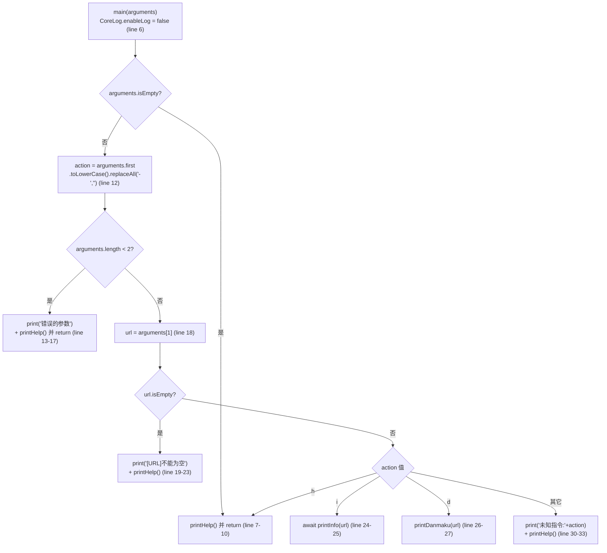
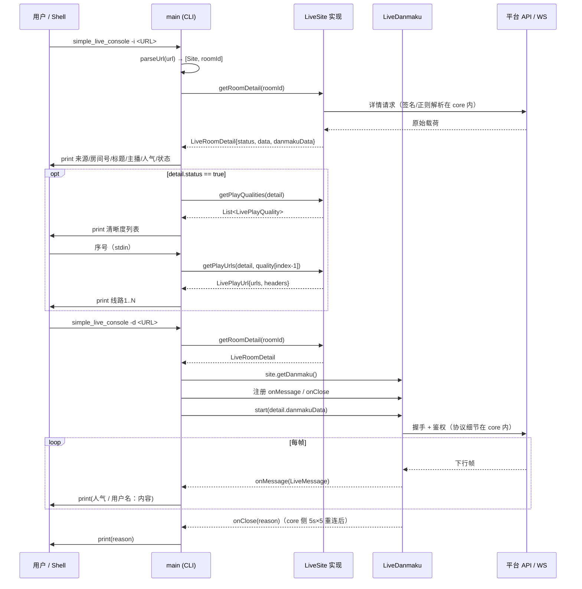

# simple_live_console 工作流程图

> 版本锚点：`simple_live_console` v1.0.0 · future 分支 `3714eec1`（2026-10-11）
> 复核：截至 `5ae375f1`（2026-10-14）`simple_live_console` 源码无变化，本文件全部证据仍然有效。
> 配套文档：[architecture.md](./architecture.md)｜[update-history.md](./update-history.md)｜[backlog.md](./backlog.md)｜[test-suite.md](./test-suite.md)｜上游依赖：[simple_live_core 知识库](../../simple_live_core/doc/workflow-diagram.md)

## 0. 定位与调用边界

`simple_live_console` 是一个**单文件 CLI**（`bin/simple_live_console.dart`，120 行），只做两件事（`bin/simple_live_console.dart:36-39`）：

- `-i [URL]`：抓直播间详情 → 列清晰度 → **交互式**选择档位 → 打印播放直链；
- `-d [URL]`：抓直播间详情 → 挂弹幕长连接 → 持续打印人气值与聊天。

它不做 UI、不做播放、不做搜索 / 列表 / SC；所有平台数据都来自 `simple_live_core` 的 `LiveSite` 接口。

## 1. main 入口：参数解析与分发

要点：参数解析是**手写**的（`arguments.first` / `arguments[1]`），未引入 `package:args`。
`replaceAll('-','')` 使 `-i` / `--i` 等价，但也意味着 `-h` 单独出现时因 `length<2` 走不到 `h` 分支（见 [backlog P1-1](./backlog.md)）。

## 2. 两条业务子流程

```mermaid
flowchart TD
    subgraph INFO["printInfo(url) —— 详情 + 清晰度 + 直链 (line 41-71)"]
        I1["parseUrl(url) → [site, id] (line 42-44)"] --> I2["site.getRoomDetail(roomId:id) (line 45)"]
        I2 --> I3["打印 来源/房间号/标题/主播/人气/状态 (line 46-51)"]
        I3 --> I4{"detail.status?"}
        I4 -- "false" --> IEND["结束（未开播无清晰度）"]
        I4 -- "true" --> I5["site.getPlayQualities(detail) (line 54)"]
        I5 --> I6["打印清晰度列表 + 提示输入序号 (line 56-59)"]
        I6 --> I7["stdin.readLineSync() 读取序号 (line 60)"]
        I7 --> I8["index = int.tryParse(input) ?? 0 (line 62)"]
        I8 --> I9{"index > 0?"}
        I9 -- "否" --> IEND
        I9 -- "是" --> I10["site.getPlayUrls(detail, quality[index-1]) (line 65)"]
        I10 --> I11["打印 线路1..N (line 66-68)"]
    end

    subgraph DM["printDanmaku(url) —— 详情 + 弹幕 (line 73-98)"]
        D1["parseUrl(url) → [site, id]"] --> D2["site.getRoomDetail(roomId:id) (line 77)"]
        D2 --> D3["打印 来源/房间号/标题/主播/状态 (line 78-82)"]
        D3 --> D4["danmaku = site.getDanmaku() (line 83)"]
        D4 --> D5["注册 onMessage / onClose (line 84-93)"]
        D5 --> D6["danmaku.start(detail.danmakuData) (line 96)"]
        D6 --> D7["await Future(() {}) 保持进程存活 (line 97)"]
    end
```

## 3. 与 core 的时序

## 4. 覆盖 / 未覆盖的能力（对照 core 的 `LiveSite`）

core 接口定义见 `simple_live_core/lib/src/interface/live_site.dart`（下表 core 成员名单按 `5ae375f1` 核对）。

| core 成员 | console 是否使用 | 证据 |
| --- | --- | --- |
| `name`（字段） | ✅ | `bin/simple_live_console.dart:46`（`来源：${site.name}`） |
| `getDanmaku()` | ✅ | `:83`（`-d`） |
| `getRoomDetail()` | ✅ | `:45`（`-i`）、`:77`（`-d`） |
| `getPlayQualities()` | ✅ | `:54`（仅在 `detail.status` 为真时） |
| `getPlayUrls()` | ✅ | `:65` |
| `getCategories()` / `searchRooms()` / `searchAnchors()` | ❌ | — |
| `getCategoryRooms()` / `getRecommendRooms()` | ❌ | — |
| `getLiveStatus()` / `getSuperChatMessage()` | ❌ | — |
| `setSiteAttrs()` | ❌ | 全文件未调用 → cookie / UA 不可注入；core 侧入参现为 JSON 串（`simple_live_core/lib/src/interface/live_site.dart:103`，口径见 [backlog P1-3](./backlog.md)） |

平台覆盖：`parseUrl` 只识别 4 个域名（`bin/simple_live_console.dart:101-118`）。

| 平台 | 是否支持 | 证据 |
| --- | --- | --- |
| bilibili | ✅ | `:101-105` |
| huya | ✅ | `:106-109` |
| douyu | ✅ | `:110-113` |
| douyin | ✅ | `:114-118` |
| twitch | ❌ | 无分支；落到 `:119` `throw Exception("链接解析失败")` |

## 5. 错误处理现状（无兜底）

- **无任何 `try/catch`**：`main` / `printInfo` / `printDanmaku` / `parseUrl` 中的异常（`CoreError`、`Exception("链接解析失败")`、`RangeError` 等）直接抛到顶层，进程以非零码退出并打印 Dart 栈（`bin/simple_live_console.dart:41-119`）。
- `quality[index - 1]`（`:65`）在 `index` 大于清晰度条数时抛 `RangeError`，未做上界校验（见 [backlog P0-1](./backlog.md)）。
- 输出为中文纯文本 + 帮助，无统一错误码 / 结构化输出，脚本侧难以机读。