# simple_live_core 工作流程图

> 版本锚点：`simple_live_core` v1.1.0 · future 分支 `5ae375f1`（2026-10-14）
> 配套文档：[architecture.md](./architecture.md)｜[update-history.md](./update-history.md)｜[backlog.md](./backlog.md)｜[test-suite.md](./test-suite.md)

## 0. 定位与调用边界

本库只做「把直播平台的数据拿到手」，不做 UI、不做播放：

- **上游消费者**：`simple_live_app`（`lib/services/platform_service.dart` 持有 5 个 Site 单例）、`simple_live_tv_app`、`simple_live_console`、`example/simple_live_core_example.dart`。
- **对外只暴露两个入口**：
  - `LiveSite`（`lib/src/interface/live_site.dart`）：房间列表 / 详情 / 清晰度 / 播放地址 / 搜索 / 分类 / 状态查询。
  - `LiveDanmaku`（`lib/src/interface/live_danmaku.dart`）：弹幕长连接（由 `site.getDanmaku()` 创建）。
- **平台实现**：`BiliBiliSite` / `DouyuSite` / `HuyaSite` / `DouyinSite` / `TwitchSite`（`implements LiveSite`）。

## 1. 总览：两条主链路

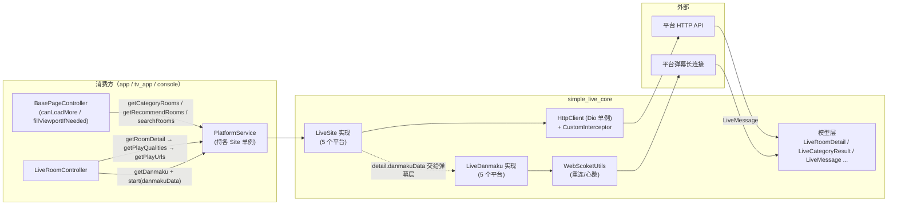

要点：
- **列表链路**与**弹幕链路**在 `getRoomDetail` 处交汇：详情里同时返回页面数据（`data`）与弹幕连接参数（`danmakuData`），后者是 `dynamic`，只有对应平台的 `LiveDanmaku` 认识它。
- 播放地址的获取分三段（`lib/src/platforms/readme.md`）：`getRoomDetail → getPlayQualities → getPlayUrls`，中间用 `LivePlayQuality.data`（`dynamic`）串起平台私有中间态。

## 2. 播放链路时序（以 App 进入直播间为例）

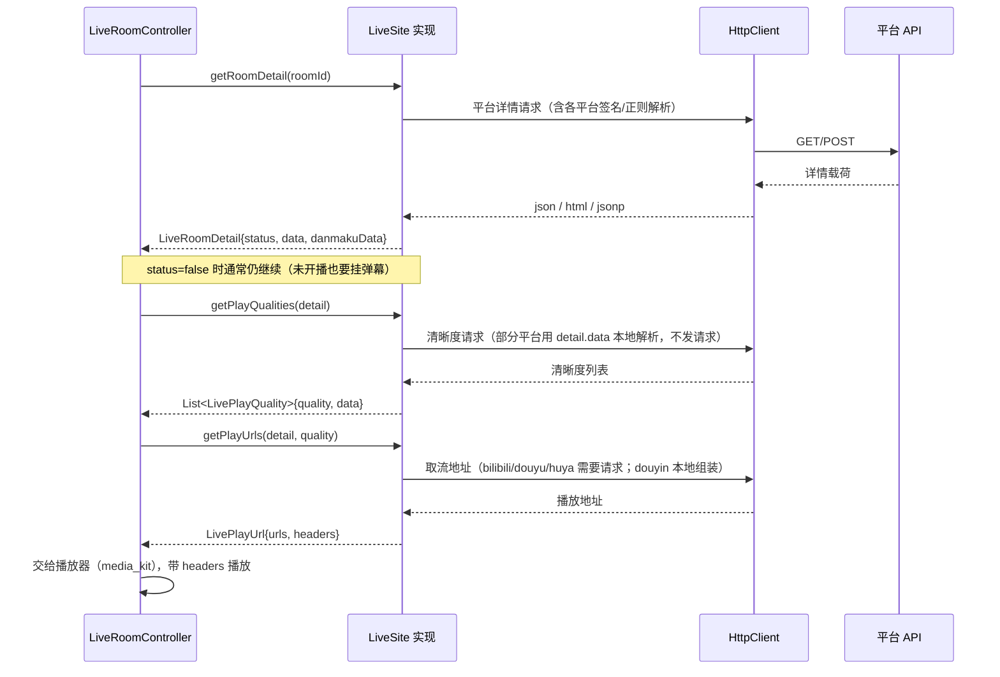

分段职责与特例：

| 阶段 | 常规做法 | 特例 |
| --- | --- | --- |
| `getRoomDetail` | 请求 JSON 接口 | 虎牙：抓网页 HTML 用正则抠 `TT_ROOM_DATA` / `stream`；抖音：`roomId` 位数分流 `reflow/info` 与 `web/enter`，连麦房间走补查 |
| `getPlayQualities` | 请求接口拿清晰度列表 | 虎牙：从 `detail.data`（`HuyaUrlDataModel`）本地组装；抖音：解析 `live_core_sdk_data`，缺失时回退 `flv_pull_url`/`hls_pull_url_map` |
| `getPlayUrls` | 接口换真实流地址 | 抖音：直接用清晰度阶段已带出的地址；虎牙：逐条线路请求 tars `getCdnTokenInfoEx` 再拼 antiCode |
| 播放 | `LivePlayUrl.urls` 多条线路 | bilibili：把含 `mcdn` 的线路排到最后；douyu：`fcdn=ws & expire=300` 时追加 `&expire=0`（海外临时方案） |

## 3. 弹幕链路时序与状态机

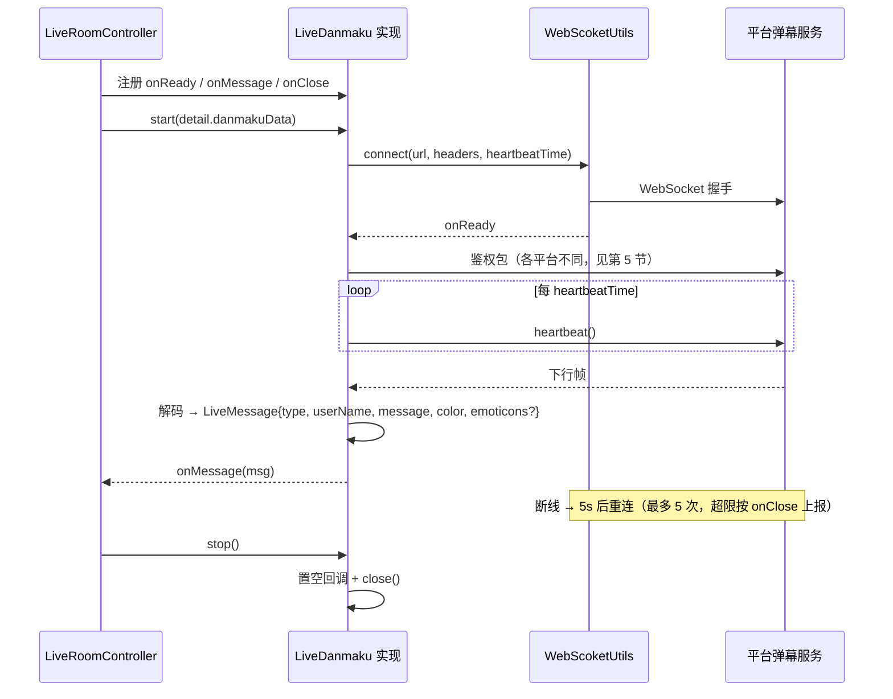

状态机（`lib/src/common/web_socket_util.dart`）：

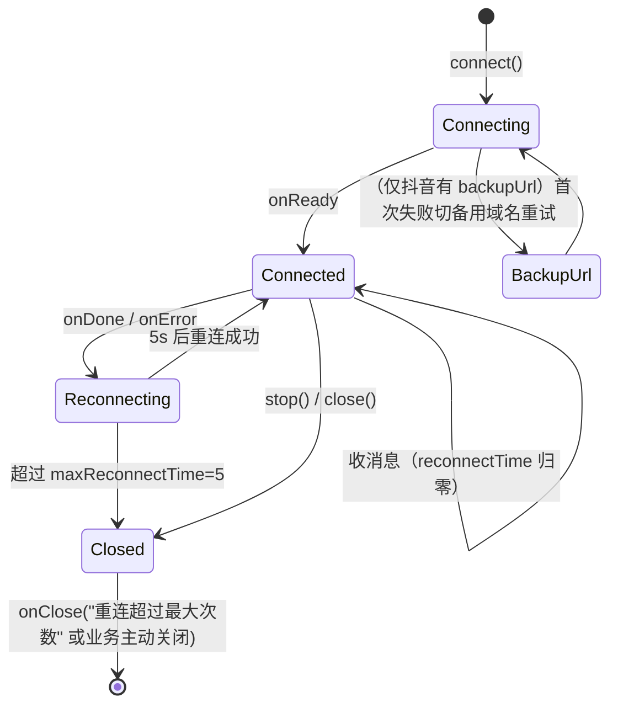

消费者侧的约定：
- `stop()` 后回调被置空，不会再收到任何事件（各平台实现一致）。
- 「未开播」也要能挂弹幕（虎牙因此有 `HuyaDanmakuArgs(0,0,0)` 兜底，见 `huya_site.dart:345`）。

## 4. 分页语义与 hasMore（fork 的核心工程约定）

这一条贯穿「分类页 / 推荐页 / 搜索页」，App 的 `BasePageController.canLoadMore`（`simple_live_app/lib/app/controller/base_controller.dart:220`）直接采信 core 的 `hasMore`：

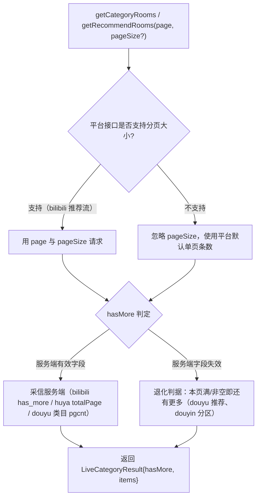

各平台判据对照（约定：**判据失效会直接表现为「列表卡在第一页、刷新无效」**，所以每条判据都配了回归测试）：

| 接口 | 判据 | 备注 |
| --- | --- | --- |
| bilibili `getCategoryRooms` | 服务端 `has_more == 1` | 单页固定 30，忽略 `pageSize` |
| bilibili `getRecommendRooms` | 本页非空 | `page_size` 可参数化（默认 30），是唯一真正使用 `pageSize` 的平台 |
| douyu `getCategoryRooms` | `page < pgcnt` | 该接口 `pgcnt` 仍有效 |
| douyu `getRecommendRooms` | 本页非空 | 2026-09 实测 `pgcnt` 恒为 0，**不能**用 `page < pgcnt` |
| huya 分类/推荐 | `page < totalPage` | 同一接口 `cache.php?m=LiveList` |
| douyin `getCategoryRooms` | 本页条数 ≥ count（满页） | `count` 固定 15：>20 时服务端只返 20 |
| douyin `getRecommendRooms` 第 1 页 | 固定 `hasMore: true` | feed 池只有 45~65 间，翻不动页，必须声明还有更多让 App 走续接 |
| douyin `getRecommendRooms` 第 2 页起 | 分区接口本页非空（分区分轮转，一圈全空才到底） | 见第 5.4 节 |
| twitch | 无分页（搜索/推荐不支持） | — |

## 5. 平台专属流程

### 5.1 bilibili

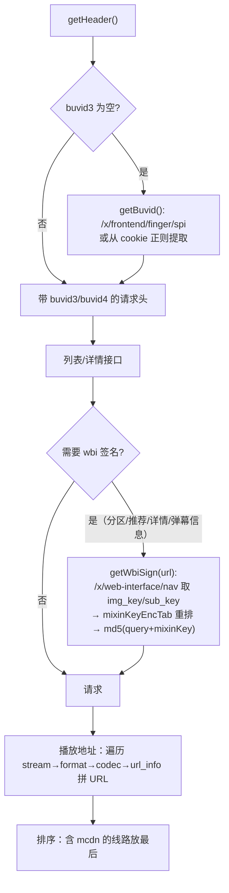

- 弹幕：`wss://{host}/sub`，自研 16 字节包头 + 协议版本 0(JSON)/1(人气)/2(zlib)/3(brotli)；`protover:3` 鉴权包里的 `uid` 取站点 `userId`（登录校验成功后由 `getAccountInfo` 回填 `mid`，`bilibili_site.dart:622`；`getRoomDetail` 再填入 `BiliBiliDanmakuArgs.uid`，`:250-257`），必须与握手头里的 cookie 配对（`bilibili_danmaku.dart:91`、`:63-67`）；60s 心跳。表情包解析见 `bilibili_emoticon.dart`（fork 新增）。
- 账号：`getQRCode` 走 `passport.bilibili.com/x/passport-login/web/qrcode/generate`，`getQRPollResult` 走 `.../poll`（服务端 code 86038=过期、86090=已扫、0=确认并从 `set-cookie` 汇总 cookie，包装成 JSON credential `{"cookie": ...}`，`bilibili_site.dart:600`）；`setSiteAttrs` 现在也**按 JSON 取 `cookie` 键**（`bilibili_site.dart:553-558`，上游 `57d8f86d` 经 `5ae375f1` 并入），与上面的 credential 形态正好配对——旧实现把整串当裸 cookie 用，登录后 B 站请求仍不带有效凭证。另有 webLogin 迁移（上游 `9abf40ff`）。

### 5.2 斗鱼

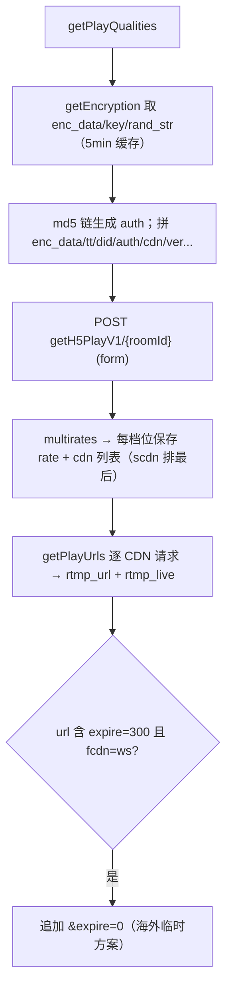

- cookie：`DouyuUtils` 解析 `acf_jwt_token` 的 exp 判断过期，用 `safeAuth` 刷新（`douyu_utils.dart:49-90`）；`setSiteAttrs` 注入 JSON（键 `cookie`/`dy_did`/`LTP0`）并同步 `dy_did`。
- 弹幕：`danmuproxy.douyu.com:8506`，自制 STT 文本协议；**只受理 `fans=='1'` 的弹幕**（历史行为，见 backlog）。
- 账号：`getQRCode` 先请求 did 再 `scan/generateCode`；`getQRPollResult` 轮询 `japi/scan/auth`（error -2=未扫、1=已扫、-1=过期、0=确认，确认时从 `set-cookie` 取 LTP0 并 `refreshCookie` 拼出 `{dy_did, LTP0, cookie}`）；`getAccountInfo` 复用 `refreshCookie` 回填昵称/头像/uid（`douyu_site.dart:344-450`）。

### 5.3 虎牙

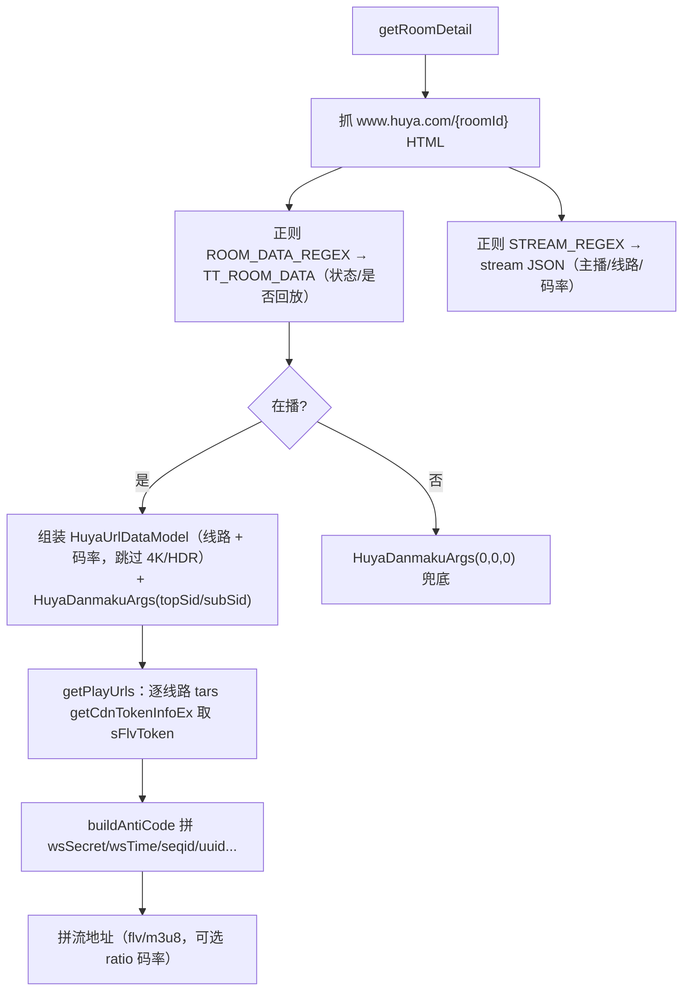

- 弹幕：`wss://cdnws.api.huya.com` + tars 编解码；注册 `live:$pid` / `chat:$pid` 组；60s 心跳；SC 为「WS 信号 + HTTP 拉取」（`huya_utils.dart`）。
- VIP 房间名单硬编码在 `huya/common/huya_vip_room_id.dart`（4K 需 VIP，直接跳过该档位）。

### 5.4 抖音

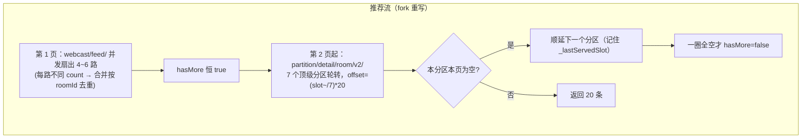

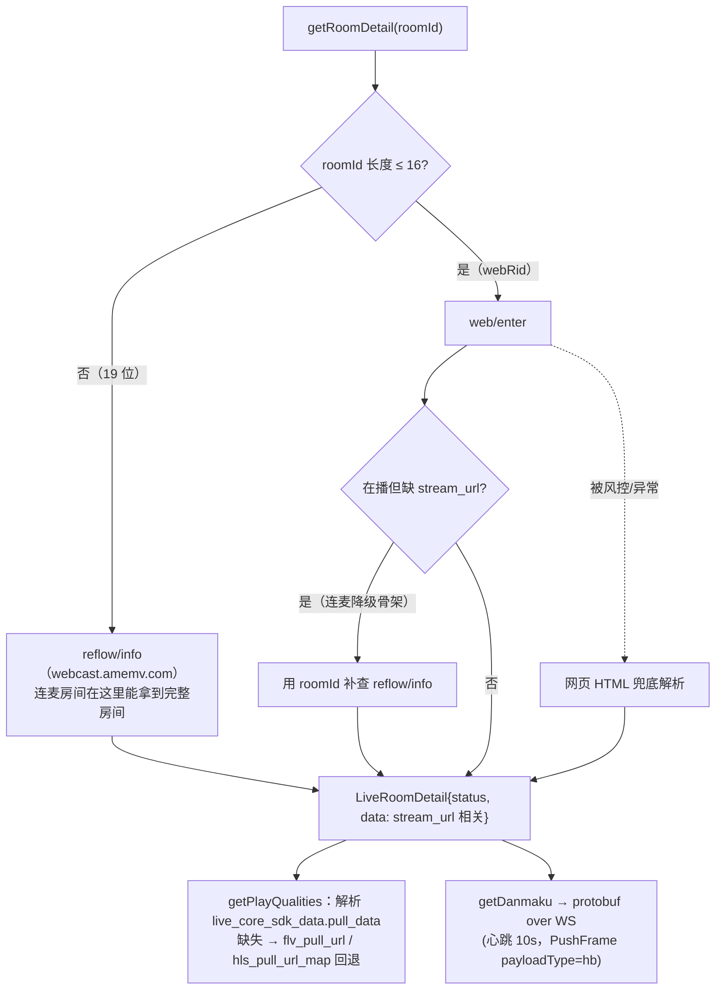

- 反爬：HTTP 侧 abogus（`douyin_utils.dart buildRequestUrl`，补 `aid/msToken` 等后签名）；弹幕 WS 侧 xbogus（`getSignature`：13 个字段逗号拼接 → md5 → `generateXBogus`）。
- 搜索：`www.douyin.com/aweme/v1/web/live/search/`，`count=10`、`offset=(page-1)*10`；被风控（返回空）时抛「抖音直播搜索被限制」。

### 5.5 Twitch

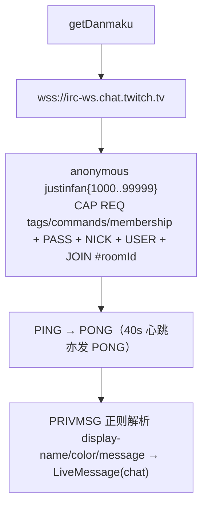

- 不支持：搜索房间/主播、SC、推荐/分类（`twitch_site.dart` 中标注「尚不支持」）。房间详情来自 `twitch_models.dart` 的 gql 请求。

## 6. 失败与兜底路径

| 位置 | 行为 |
| --- | --- |
| `HttpClient` 所有方法 | 捕获 `DioException`，`badResponse` 时抛 `CoreError(message, statusCode)`；其余一律抛 `CoreError("发送GET/POST请求失败")` |
| `HttpClient.head` | 特殊：`badResponse` 时**返回 response 而非抛错**（供抖音 ttwid 探测） |
| 虎牙 `getPlayUrls` | 单条线路失败只记日志（`CoreLog.e`）并跳过，不影响其他线路（修复于 `d02d2e49`） |
| 抖音详情 | web/enter 与网页兜底都拿不到房间时抛 `CoreError`（用户可读），绝不抛空指针（`linkmic` 修复） |
| 抖音分区/分类 | 响应结构异常（`data` 为 null/List）按空页处理；单条脏数据只跳过该条，且 `hasMore` 看原始条数 |
| 抖音推荐首屏 | 个别切片失败不影响整页；**全部切片失败才上抛** `CoreError`；全部为空按空页处理 |
| 斗鱼推荐 | 响应缺 `rl` 字段按空页处理 |
| 弹幕 | 解码异常只记 `CoreLog`，不打断长连接（抖音在 `onMessage` 内有二次 try/catch） |

## 7. 消费方需要知道的接口约定

1. `getRecommendRooms` / `getCategoryRooms` 的 `pageSize` 是**期望值**，不是保证值；只有 bilibili 推荐流真正使用（v1.1.0 起）。
2. `LiveRoomDetail.danmakuData` 与 `LiveRoomDetail.data` 是平台私有 `dynamic`，不要跨平台复用；替换数据要经 `updateData()/updateDanmakuData()`（属性为 `final`）。
3. `getPlayUrls` 返回多条线路，播放器按顺序尝试；`headers` 必须透传给播放器（bilibili 需要 referer/UA，虎牙需要 HYSDK UA）。
4. 弹幕要先 `start(detail.danmakuData)` 再等 `onReady`；`stop()` 之后该实例不可复用（重连逻辑已被关闭）。
5. 未开播房间：`status == false` 但通常仍应挂弹幕（直播间可能在播中开播/下播切换）；各平台已为闭播状态提供弹幕参数兜底。
6. 账号能力（v1.8.15 起）属于 `LiveSite`：`getQRCode → getQRPollResult → getAccountInfo → setSiteAttrs`；`setSiteAttrs` 入参统一为 `String`，5 个平台（twitch 除外，仍是桩）内部一律 `jsonDecode` 后按键注入——bilibili 取 `cookie`（自 `5ae375f1`）、douyu 取 `cookie`/`dy_did`/`LTP0`、huya 只取 `ua`、douyin 取 `cookie`/`hlsFirst`，详见 §8。

## 8. 账号链路（v1.8.15 新增，`abca65f8`；B 站凭证注入修正于 `5ae375f1`）

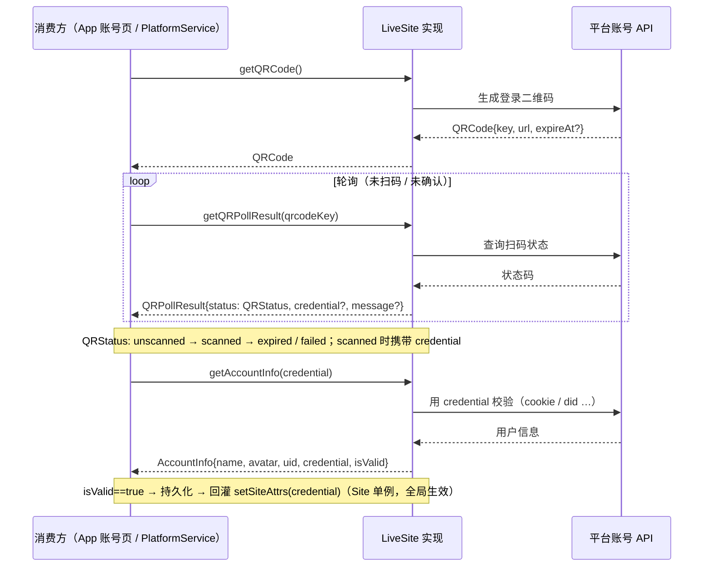

各阶段与实现进度：

| 步骤 | 接口 | 说明 | bilibili | douyu | huya | douyin | twitch |
| --- | --- | --- | --- | --- | --- | --- | --- |
| 1 | `getQRCode()` | 生成登录二维码 | ✅ | ✅（先取 did） | TODO 桩 | TODO 桩 | TODO 桩 |
| 2 | `getQRPollResult({qrcodeKey})` | 轮询扫码状态 | ✅（scanned 回 `{cookie}`，`bilibili_site.dart:600`） | ✅（scanned 回 `{dy_did,LTP0,cookie}`） | TODO 桩 | TODO 桩 | TODO 桩 |
| 3 | `getAccountInfo({credential})` | 校验凭证换账号信息 | ✅（顺带回填站点 `userId`，`bilibili_site.dart:622`） | ✅（`refreshCookie`） | TODO 桩 | ✅（cookie→`webcast/user/me`） | TODO 桩 |
| 4 | `setSiteAttrs(String)` | 注入凭证并全局生效 | ✅ JSON(cookie) | ✅ JSON | ✅ JSON(ua) | ✅ JSON(cookie/hlsFirst) | TODO 桩 |

- **credential 形态**：四个已实现的平台都是 **JSON 串**，实现内 `jsonDecode` 后按键注入：bilibili 只取 `cookie`（`bilibili_site.dart:553-558`，与 `getQRPollResult` 产出的 `{"cookie": ...}` 配对，`:600`）、douyu 取 `cookie`/`dy_did`/`LTP0`（`douyu_site.dart:344-356`）、huya 只取 `ua`（`huya_site.dart:559-564`）、douyin 取 `cookie`/`hlsFirst`（`douyin_site.dart:1233-1246`）。缺某个键时一律静默保留旧值（`if (map.containsKey(...))` 形态），不做校验。
- **QRStatus 流转**：`loading / unscanned → scanned → expired / failed`（`qr_status.dart`）。bilibili 按服务端 code 86038=expired、86090=scanned、0=scanned（并从 `set-cookie` 汇总 cookie）；douyu 按 error -2=unscanned、1=scanned、-1=expired、0=确认。
- **注入时机**：`getAccountInfo.isValid == true` 后由调用方 `setSiteAttrs` 回灌；因 Site 是单例，登录后全局请求即带上凭证。
- **实现进度差异**：huya 三接口、douyin 的 `getQRCode/getQRPollResult`、twitch 三接口 + `setSiteAttrs` 均是 `UnimplementedError` 桩（见 backlog）。