# simple_live_core 工作流程图

> 版本锚点：future `4795b165` + 2026-10-18 Dart core 清理
> 所有链路均为 **Rust 实现**；Dart 只负责模型翻译与回调桥接，CLI 完全绕开 FRB。
> 配套：[architecture.md](./architecture.md)｜[update-history.md](./update-history.md)｜[backlog.md](./backlog.md)｜[test-suite.md](./test-suite.md)

## 0. 定位与调用边界

本库只做「把直播平台的数据拿到手」，不做 UI、不做播放。

- **消费者**：`simple_live_app`、`simple_live_tv_app`（经 FRB 绑定层）、`crates/slive-cli`（直接依赖 `slive-core`）。
- **对外两个入口**：
  - `LiveSite`（`lib/src/interface/live_site.dart`）：房间列表 / 详情 / 清晰度 / 播放地址 / 搜索 / 分类 / 状态 / 账号。
  - `LiveDanmaku`（`lib/src/interface/live_danmaku.dart`）：弹幕长连接，由 `site.getDanmaku()` 创建。
- **实现**：`RustBilibiliSite` / `RustDouyuSite` / `RustHuyaSite` / `RustDouyinSite` / `RustTwitchSite`（`lib/src/bridge/`，全部 `implements LiveSite`）。

## 1. 总览：两条链路 × 两个入口

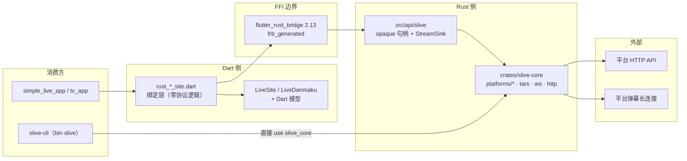

要点：**CLI 与 App 走的是同一条 Rust 核心，但 CLI 跳过 FRB**。这也是 `slive-core` 保持「零 FRB 依赖」的直接收益——同一套协议能力可被任何 Rust 前端（含 Tauri）复用。

## 2. 播放链路（App 进入直播间）

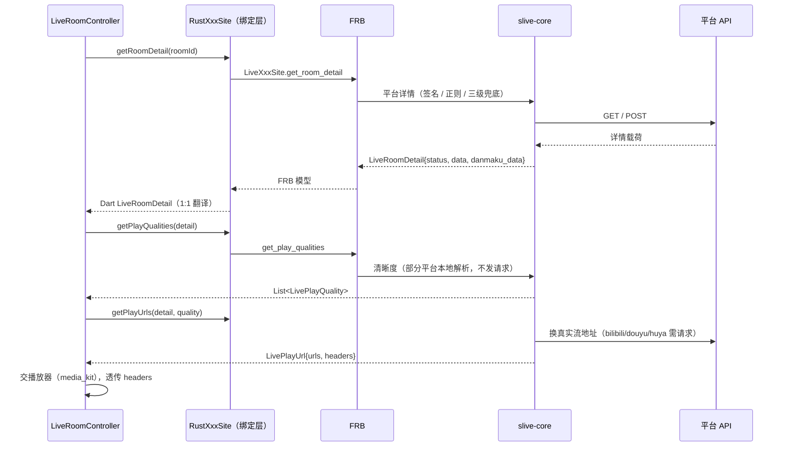

| 阶段 | 常规做法 | 特例 |
| --- | --- | --- |
| `get_room_detail` | 请求 JSON 接口 | 虎牙：抓 HTML 正则抠 `TT_ROOM_DATA` / `stream`；抖音：`roomId` 位数分流 `reflow/info` 与 `web/enter`，连麦房间补查 |
| `get_play_qualities` | 请求接口拿清晰度 | 虎牙：从 `detail.data` 本地组装；抖音：解析 `live_core_sdk_data`，缺失回退 `flv_pull_url`/`hls_pull_url_map` |
| `get_play_urls` | 接口换真实地址 | 抖音：直接用清晰度阶段带出的地址；虎牙：逐线路请求 tars `getCdnTokenInfoEx` 再拼 antiCode |
| 播放 | `urls` 多线路依次尝试 | bilibili：含 `mcdn` 的排最后；douyu：`fcdn=ws & expire=300` 时追加 `&expire=0` |

> 斗鱼续流：Rust core **不产出** `renewers`（O-7）。App 侧由控制器按「房间 + 清晰度 + 线路」登记 `StreamRenewContext`，中转到期时自己调 core 重取。

## 3. 弹幕链路

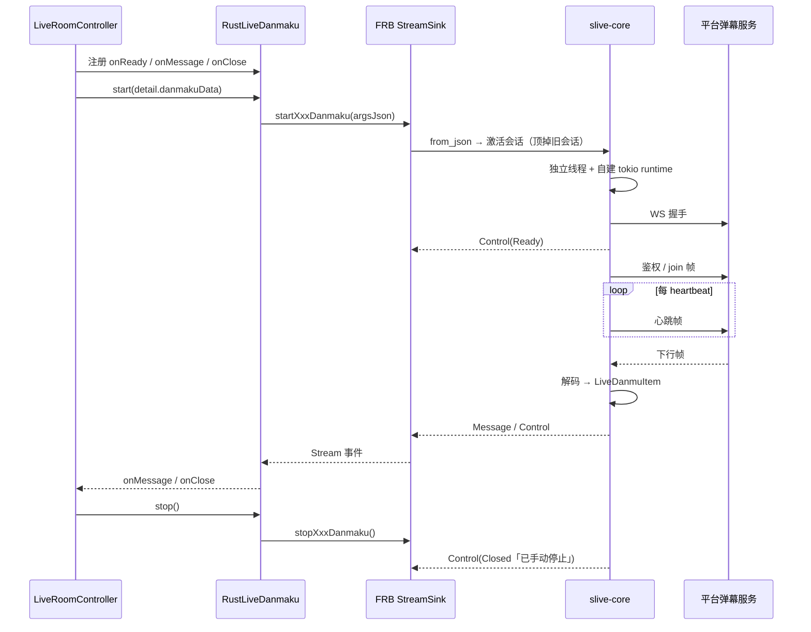

会话状态机（`crates/slive-core/src/ws/runner.rs` 及各平台 `run_session`）：

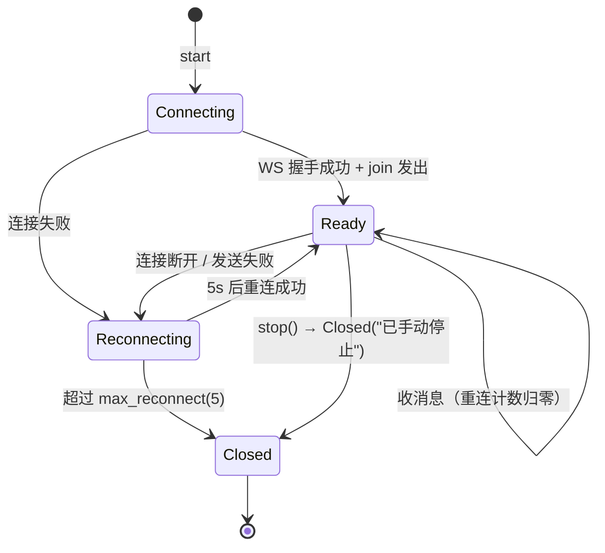

约定：
- **单房间语义**：同一平台再次 `start` 会先向旧会话的 `watch::Sender` 发 `true`，旧会话收到 `Closed("已手动停止")` 后退出。
- **未开播也要能挂弹幕**：虎牙为闭播状态提供 `HuyaDanmakuArgs` 兜底；`status == false` 时 App 仍应继续挂。
- **解码异常不打断长连接**：单条脏帧只记日志（`eprintln!` / `log`），继续收下一帧。

## 4. 分页语义与 hasMore

App 的 `BasePageController.canLoadMore` 直接采信 core 的 `hasMore`：

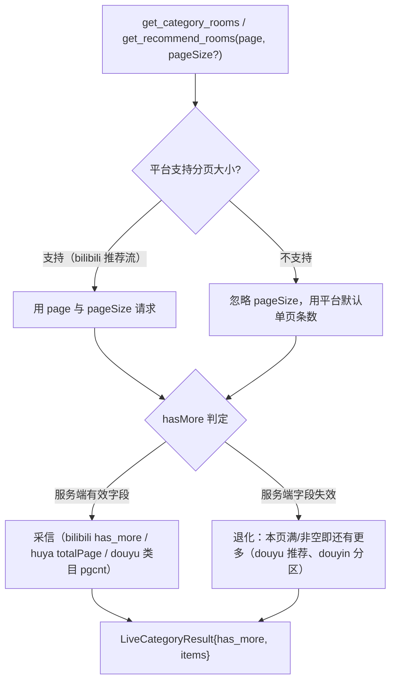

| 接口 | 判据 | 备注 |
| --- | --- | --- |
| bilibili 分类 | 服务端 `has_more == 1` | 单页固定 30，忽略 `pageSize` |
| bilibili 推荐 | 本页非空 | `page_size` 可参数化，是唯一真正使用 `pageSize` 的平台 |
| douyu 分类 | `page < pgcnt` | 该接口 `pgcnt` 仍有效 |
| douyu 推荐 | 本页非空 | 2026-09 实测 `pgcnt` 恒为 0 |
| huya 分类/推荐 | `page < totalPage` | `cache.php?m=LiveList` |
| douyin 分类 | 本页条数 ≥ count（满页） | `count` 固定 15 |
| douyin 推荐首屏 | 固定 `has_more: true` | feed 池仅 45~65 间，翻不动页 |
| douyin 推荐第 2 页起 | 分区接口本页非空（7 分区轮转） | 一圈全空才到底 |
| twitch | 无分页 | 搜索/推荐不支持 |

> 判据失效的典型症状是「列表卡在第一页、刷新无效」，所以每条判据都配了回归用例（见 test-suite.md）。

## 5. 平台专属流程

### 5.1 bilibili（`platforms/bilibili/`：`wbi.rs` `buvid.rs` `detail.rs` `play.rs`）

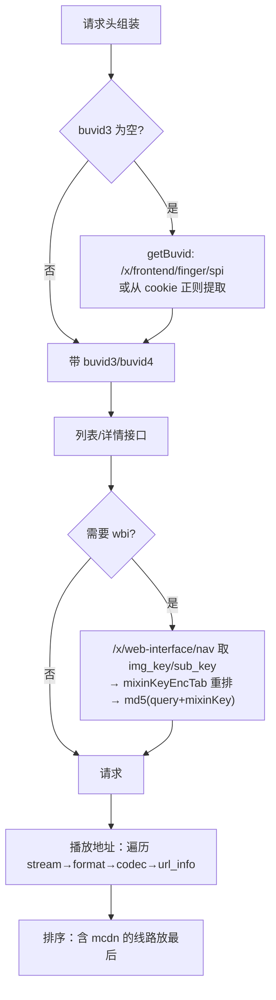

- 弹幕：`wss://{host}/sub`，16 字节包头 + 协议版本 0(JSON)/1(人气)/2(zlib)/3(brotli)；`protover:3` 鉴权包里 `uid` 取站点 `user_id`（登录校验成功后由 `get_account_info` 回填），必须与握手头 cookie 配对；60s 心跳。
- 账号：`get_qr_code` → `passport.bilibili.com/x/passport-login/web/qrcode/generate`；`get_qr_poll_result` 轮询 `.../poll`，确认时从 `set-cookie` 汇总 cookie 并包装成 `{"cookie": ...}` credential。

### 5.2 斗鱼（`platforms/douyu/`：`sign.rs` `detail.rs` `play.rs` `transport.rs`）

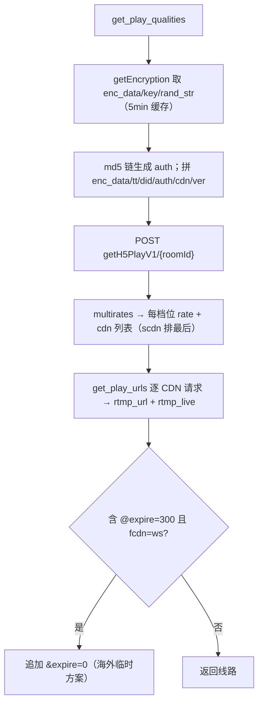

- cookie：解析 `acf_jwt_token` 的 exp 判断过期，用 `safeAuth` 刷新；`set_site_attrs` 注入 JSON（`cookie`/`dy_did`/`LTP0`）。
- 弹幕：`danmuproxy.douyu.com:8506`，自制 STT 文本协议，心跳 45s；**只受理 `fans=='1'` 的弹幕**（历史行为）。
- 账号：`get_qr_code` 先取 did 再 `scan/generateCode`；轮询 `japi/scan/auth`（-2 未扫 / 1 已扫 / -1 过期 / 0 确认）。

### 5.3 虎牙（`platforms/huya/`：`detail_parse.rs` `anti_code.rs` `tup.rs` `danmaku/`）

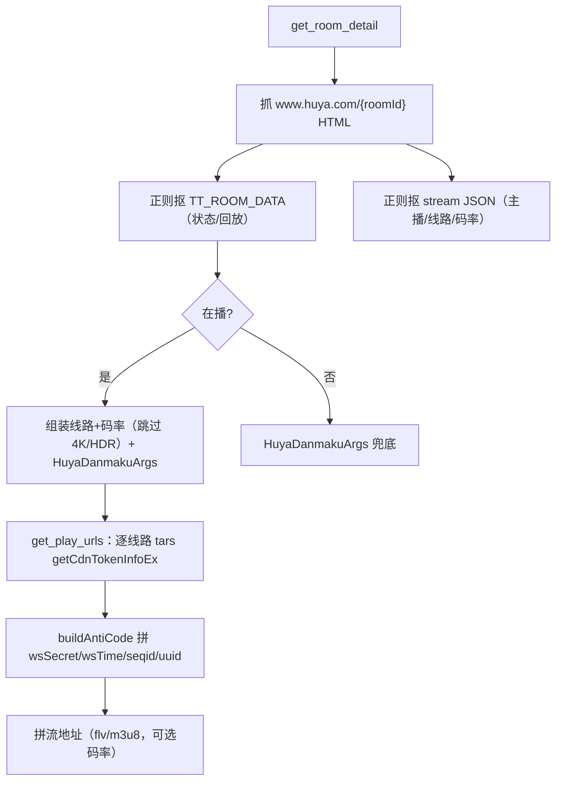

- 弹幕：`wss://cdnws.api.huya.com` + TARS 编解码；注册 `live:$pid` / `chat:$pid` 组；60s 心跳；SC 为「WS 信号 + HTTP 拉取」（`SuperChatFetcher` 由桥层注入）。
- VIP 房间名单硬编码在 `vip_room_id.rs`（4K 需 VIP，直接跳过该档位）。

### 5.4 抖音（`platforms/douyin/`：`signature/` `detail/{enter,reflow,html}` `play/branches.rs` `danmaku/`）

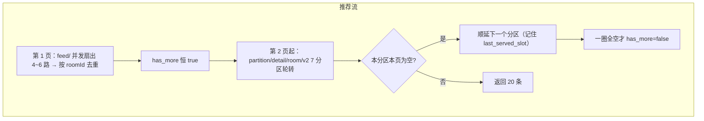

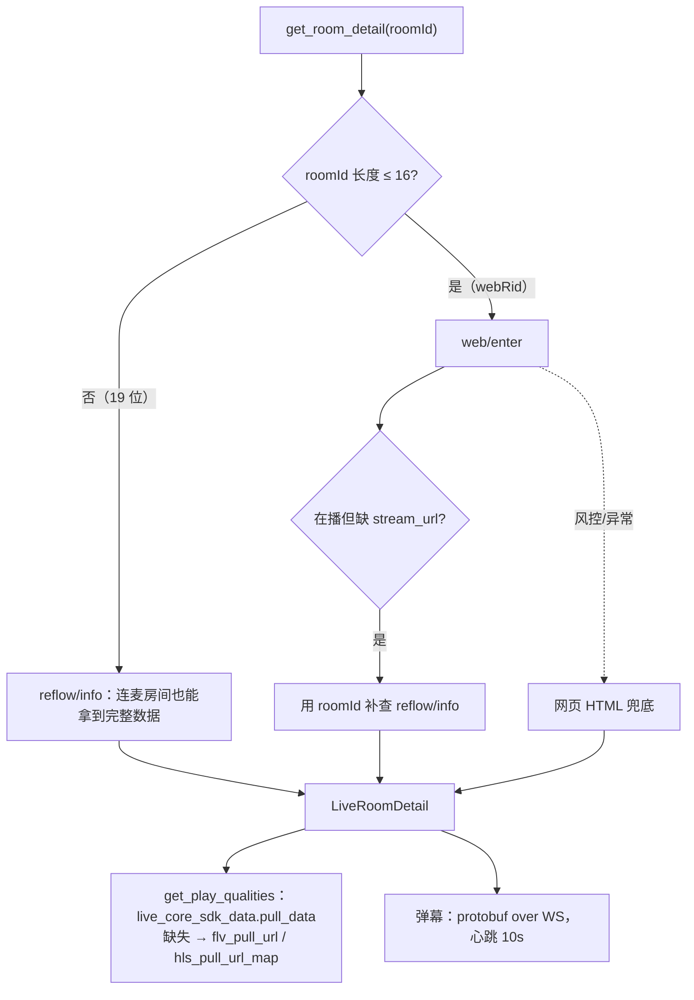

- 反爬：HTTP 侧 abogus（`signature/a_bogus.rs`，SM3+RC4）；弹幕 WS 侧 x_bogus（`signature/x_bogus.rs`）。
- 搜索：`aweme/v1/web/live/search/`，`count=10`、`offset=(page-1)*10`；被风控时抛「抖音直播搜索被限制」。

### 5.5 Twitch（`platforms/twitch/`：`gql.rs` `m3u8.rs` `unsupported.rs`）

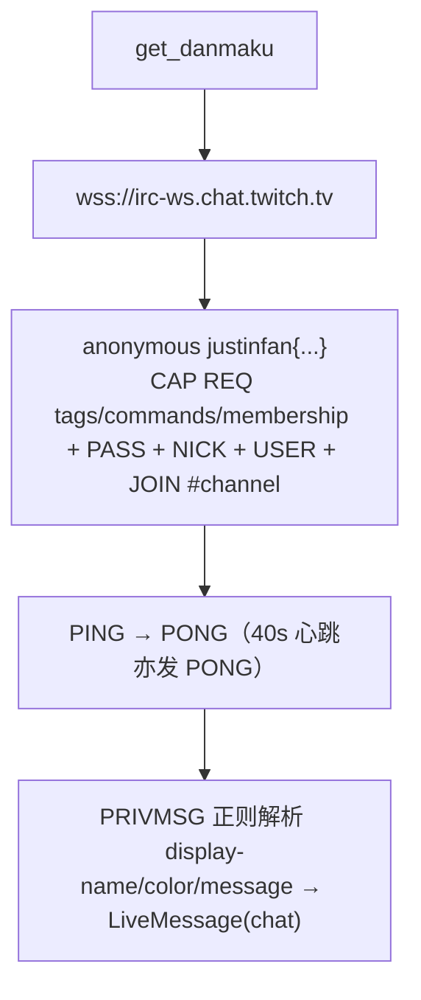

不支持项由 `unsupported.rs` 显式声明：分类/分类下房间/SC 恒空，推荐/搜索/凭证/账号恒报错（**不静默兜底**）。

## 6. 失败与兜底

| 位置 | 行为 |
| --- | --- |
| 全部 HTTP | `SliveError` 统一收敛（`Network` / `Decode` / `Api{code,message}` / `InvalidInput` / `Websocket`）；桥层映射为 `CoreError` |
| 虎牙 `get_play_urls` | 单线路失败只记日志并跳过，不影响其他线路 |
| 抖音详情 | 三级兜底都拿不到房间时抛可读错误，绝不空指针 |
| 抖音分区/分类 | 响应结构异常按空页；单条脏数据只跳过该条，`has_more` 看原始条数 |
| 抖音推荐首屏 | 个别切片失败不影响整页；**全部失败才上抛** |
| 弹幕 | 解码异常只记日志，不打断长连接 |

## 7. 消费方需要知道的约定

1. `pageSize` 是**期望值**不是保证值，只有 bilibili 推荐流真正使用。
2. `LiveRoomDetail.data` / `danmaku_data` 是平台私有通道（JSON 串），不要跨平台复用。
3. `get_play_urls` 返回多线路，按序尝试；`headers` 必须透传给播放器（B站需 referer/UA，虎牙需 HYSDK UA）。
4. 弹幕先 `start(detail.danmakuData)` 再等 `onReady`；`stop()` 后该实例不可复用。
5. 未开播房间 `status == false`，但通常仍应挂弹幕（随时可能开播）。
6. 账号链路：`getQRCode → getQRPollResult → getAccountInfo → setSiteAttrs`；`setSiteAttrs` 入参统一为 `String`，平台内 `jsonDecode` 后按键注入。

## 8. 账号链路

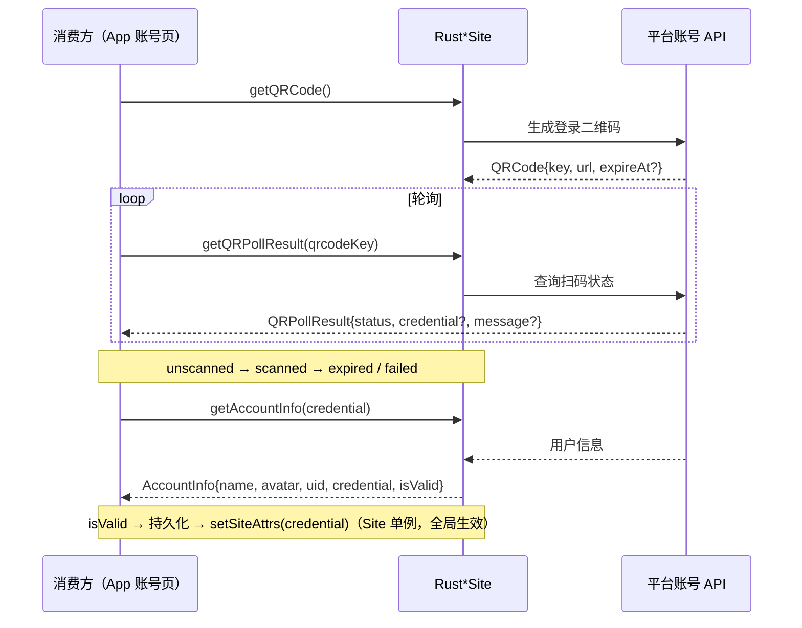

| 步骤 | bilibili | douyu | huya | douyin | twitch |
| --- | --- | --- | --- | --- | --- |
| `get_qr_code` | ✅ | ✅（先取 did） | 桩 | 桩 | 桩 |
| `get_qr_poll_result` | ✅（回 `{"cookie"}`） | ✅（回 `{dy_did,LTP0,cookie}`） | 桩 | 桩 | 桩 |
| `get_account_info` | ✅（回填 `user_id`） | ✅（`refreshCookie`） | 桩 | ✅ | 桩 |
| `set_site_attrs` | ✅ JSON(cookie) | ✅ JSON | ✅ JSON(ua) | ✅ JSON(cookie/hlsFirst) | 桩 |
