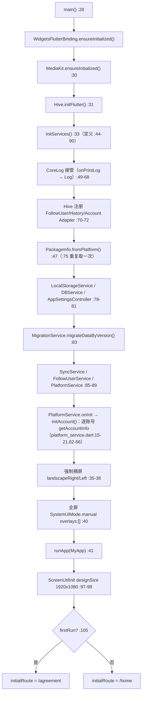
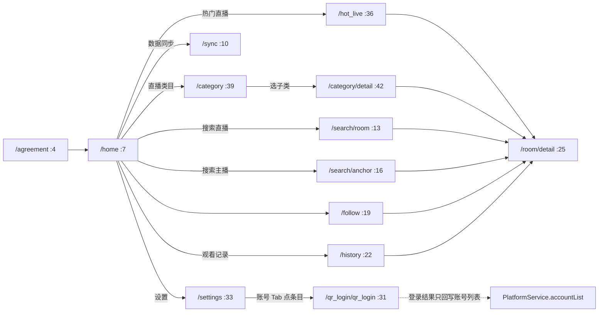
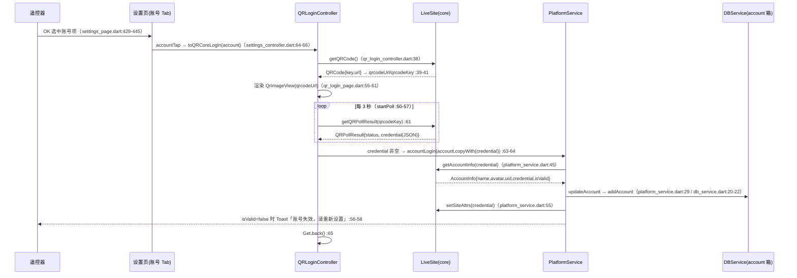
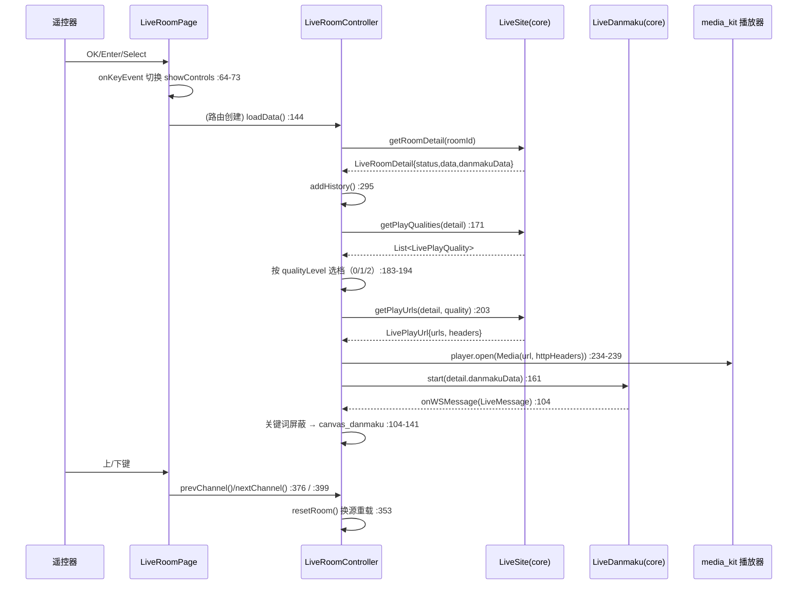
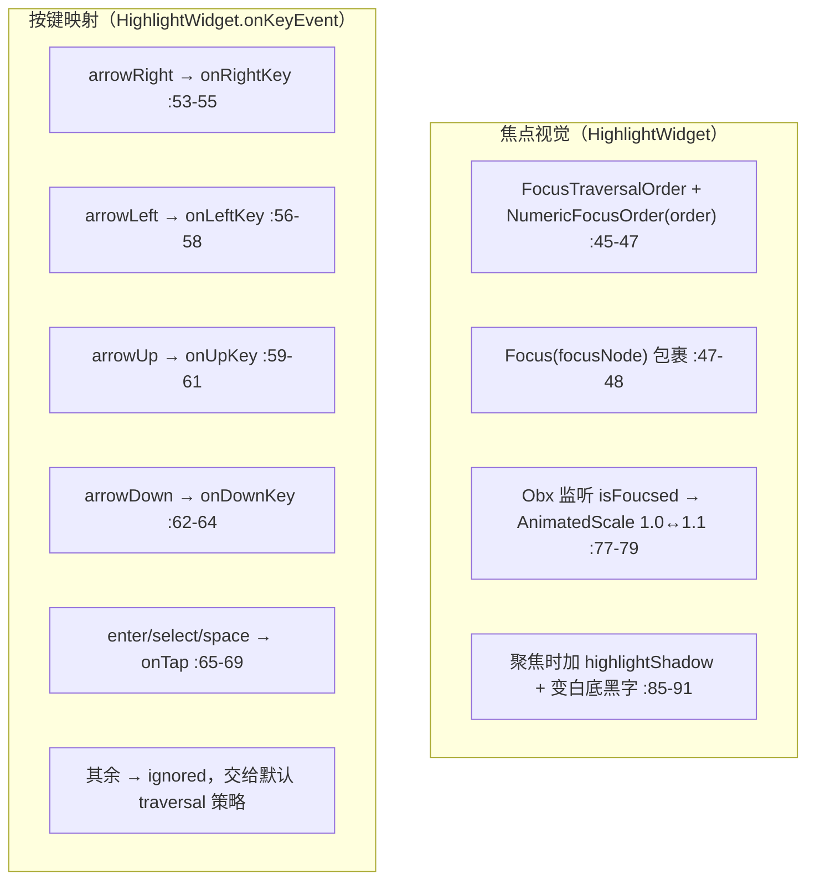

# simple_live_tv_app 工作流程图

> 版本锚点：`simple_live_tv_app` v1.5.1+10501 · future 分支 `5ae375f1`（2026-10-14）
> 配套文档：[architecture.md](./architecture.md)｜[update-history.md](./update-history.md)｜[backlog.md](./backlog.md)｜[test-suite.md](./test-suite.md)｜上游依赖：[simple_live_core 知识库](../../simple_live_core/doc/workflow-diagram.md)

## 0. 定位与调用边界

TV 端只做「大屏 UI + 遥控器交互 + 播放」，数据与协议全部下沉到 `simple_live_core`：

- **消费接口**：`lib/app/sites.dart:4-39` 持有 4 个 `LiveSite` 单例（bilibili / douyu / huya / douyin，**无 twitch**）。
- **取流契约**：`getRoomDetail → getPlayQualities → getPlayUrls`，与 `simple_live_core` 完全一致（详见 core 知识库 §2）。
- **弹幕契约**：`site.liveSite.getDanmaku()` + `start(detail.danmakuData)`，回调式（core 知识库 §3）。
- **账号契约**：全部走 core 的 `LiveSite`：`getQRCode() → getQRPollResult(qrcodeKey) → getAccountInfo(credential) → setSiteAttrs(credential)`（接口默认实现 `simple_live_core/lib/src/interface/live_site.dart:103-121`）。TV 侧只管展示二维码 + 3 秒轮询（`modules/account/qr_login/qr_login_controller.dart:35-71`），**B 站与斗鱼共用同一套扫码页**，站点由传入的 `Account.siteId` 决定（`:17`）。
- **凭证是 JSON 串，不是裸 cookie**：B 站轮询成功后下发 `jsonEncode({'cookie': <set-cookie 拼接>})`（core `bilibili_site.dart:600`），斗鱼下发 `{'dy_did','LTP0','cookie'}`（core `douyu_site.dart:443-444`）；TV 原样写入 `Account.credential`（`models/db/account.dart:16-17`），使用侧再 `jsonDecode` 取字段（core `bilibili_site.dart:553-558`、`douyu_site.dart:344-356`）。虎牙/抖音未实现扫码，core 里直接 `throw UnimplementedError()`（`huya_site.dart:567-582`、`douyin_site.dart:1290-1299`），TV 设置页把它们写成「无需登录」硬编码项（`settings_page.dart:452-478`）。
- 本工程**不改 core**，只在 `pubspec.yaml:13-14` 以 path 依赖 `../simple_live_core`。

## 1. 启动流程（`lib/main.dart`）

要点：启动期即**强制横屏 + 全屏**，并把文字缩放锁死为 1.0（`main.dart:122-127`），避免大屏字体被系统放大。`MigrationService`（`services/migration_service.dart:9-43`）在 DBService 之后、其余服务之前跑：按 `kHiveDbVer`（默认 10500）判断是否需要为 bilibili/douyu 补两条空账号记录（`id='0'/'1'`，`:19-40`），随后把 `kHiveDbVer` 写成当前版本（`:42`）。

## 2. 页面导航图

路由集中在 `lib/routes/app_pages.dart:33-147`，路径常量在 `route_path.dart`。

- 首页 5 个入口按钮：热门直播 / 直播类目 / 搜索直播 / 观看记录 / 数据同步（`home_page.dart:66-121`），另有关注区与「我的关注」入口按钮（该按钮在首页被注释，见 `home_page.dart:95-103`；`/follow` 路由仍保留，实际由 `showFollowUser` 弹窗点在房间内使用）。
- 进直播间**不再有 B 站登录拦截**（上游 `6da36e04` 删除了该分支）：`AppNavigator.toLiveRoomDetail` 现在直接 `Get.toNamed`（`app_navigation.dart:12-16`）。扫码登录的唯一入口是设置页「账号」Tab 的账号项 → `SettingsController.accountTap`（`settings_controller.dart:64-66`）→ `AppNavigator.toQRCoreLogin`（`app_navigation.dart:19-21`，参数即 `Account`）。
- 路由常量里 `kBiliBiliQRLogin = "/bilibili/qr_login"`（`route_path.dart:28`）仍留着，但已无对应 `GetPage`（`app_pages.dart:72-79` 注册的是 `kAccountQRLogin`），属死常量，见 backlog P2-7。

### 2.1 扫码登录时序（B 站 / 斗鱼共用）

- 站点分派只靠 `account.siteId`（`qr_login_controller.dart:17`），页面无 B 站分支；`getAccountInfo` 的返回决定 `isActive/userName/avatar/uid`（`platform_service.dart:46-53`）。
- 启动期 `initAccount()` 会对箱内每个账号跑一次 `accountLogin`（`platform_service.dart:15-21`），即离线时这些请求只会失败并留旧值。

## 3. 房间页流程（`modules/live_room`）

播放容错：`mediaEnd`/`mediaError` 各允许 2 次原地重试，再按 `playUrls` 顺序切下一条线路，全部用尽才置 `liveStatus=false`（`live_room_controller.dart:244-292`）。未开播但有录像时以「轮播录像」继续播放（`:152-158`）。

## 4. 遥控器焦点导航（TV 端的核心机制）

焦点系统的三块积木：

| 组件 | 位置 | 职责 |
| --- | --- | --- |
| `AppFocusNode` | `app/app_focus_node.dart:5-20` | 继承 `FocusNode`，用 `isFoucsed`（RxBool）把焦点状态暴露给 UI |
| `HighlightWidget` | `widgets/highlight_widget.dart:10-100` | 统一把子组件包成可聚焦项：焦点视觉 + 按键映射 |
| `SettingsItemWidget` | `widgets/settings_item_widget.dart:8-128` | 左右键在枚举项间循环取值 |

- **四向移动**：组件默认不拦截方向键（返回 `ignored`），由 Flutter 默认焦点遍历策略做空间导航；只有需要自定义跳转的组件（如 `SettingsItemWidget`）才覆写 `onLeftKey/onRightKey`（`settings_item_widget.dart:31-50`）。
- **确认键**：`enter` / `select` / `space` 视作点击（`highlight_widget.dart:65-69`）。
- **房间内按键**（`live_room_page.dart` 的 `KeyboardListener`，`:37-40` 注册）：

| 按键 | 行为 | 位置 |
| --- | --- | --- |
| OK / Enter / Space | 显示/隐藏控制器 | `live_room_page.dart:64-73` |
| Menu / M / → | 打开播放设置（清晰度/线路/比例/弹幕） | `:76-81` |
| ← | 打开「我的关注」弹窗切台 | `:84-87` |
| ↑ | 上一频道 | `:101-104` |
| ↓ | 下一频道 | `:107-110` |
| 返回键 | `PopScope` 双击退出（2s 窗口） | `:19-36` |

- **播放器设置对话框**内的每一项用 `SettingsItemWidget`，左右键直接循环切换并落盘（`player_controls.dart:324-598`）。
- 弹窗关闭后会把焦点还原到播放器 `focusNode`（`player_controls.dart:594-597`、`:685-688`）。

## 5. 与手机端 `simple_live_app` 的流程差异

| 维度 | TV 端 | 手机端 | 原因 |
| --- | --- | --- | --- |
| 输入方式 | 遥控器焦点 + 方向键（无触屏） | 触摸手势 | 大屏设备无触摸 |
| 首页 | 单页大按钮导航 | 底部导航 Dock 多 Tab | 遥控器不适合 Tab |
| 用户协议 | 独立路由 `/agreement`（首次运行） | — | TV 无「我的」页承载协议 |
| 平台覆盖 | 4 个（**无 twitch**，`sites.dart:5-34`） | 含 twitch | 设计取舍，见 backlog |
| 弹幕发送 | 无输入框（仅接收展示） | 有聊天区/发送 | 遥控器打字体验差 |
| 后台播放/小窗 | 无（无 audio_service/PIP） | 有 | TV 常亮横屏，无抓取场景 |
| 远程同步 | UDP 发现 + 本机 HTTP 服务（被同步端） | 含 WebDAV/扫码/房间多模式 | TV 只做「被同步」的接收端 |
| 登录 | B 站 + 斗鱼二维码，共用通用扫码页（`modules/account/qr_login/`），账号存 Hive `account` 箱 | B站/斗鱼二维码 + 网页登录、多账号切换（`support*Login` 字段） | TV 无网页登录，账号槽位由迁移脚本建（`migration_service.dart:19-34`） |
| 播放器 | media_kit（pub 源） | media_kit（自定义 git fork）+ rust | 见 architecture.md |
| 多开 / 多路播放 | 无 | 有（`multi_play`） | TV 未适配 |

## 6. 交叉索引（去 core 看）

- 取流三段式与各平台特例：`simple_live_core/doc/workflow-diagram.md` §2。
- 弹幕时序/状态机与重连：同上 §3。
- 分页 `hasMore` 契约：同上 §4（**注意 TV 端未采信该字段，见 backlog**）。
- 平台专属流程（bilibili wbi / douyu 签名 / huya 网页正则 / douyin abogus）：同上 §5。